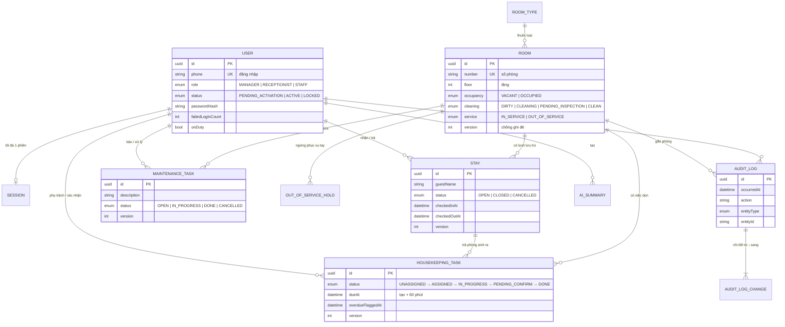

# Thiết kế CSDL (bản nháp để review)

> Gộp 9 file `docs/features/*/srs/*-erd.md` thành **một** schema PostgreSQL + Prisma.
> File code: [`server/prisma/schema.prisma`](../../server/prisma/schema.prisma) — đã migrate (`init` + `align_with_specs`), có test đối chiếu spec: `server/tests/spec-rules.test.ts`.
> Người soạn: Kim (backend) · 23/09/2026.

## 1. Sơ đồ quan hệ

**12 bảng:** `users`, `sessions`, `room_types`, `rooms`, `stays`, `housekeeping_tasks`, `maintenance_tasks`,
`out_of_service_holds`, `audit_logs`, `audit_log_changes`, `ai_summaries`, `ai_quotas`.

## 2. Đối chiếu với ERD trong docs

| ERD trong docs | Trong schema | Ghi chú |
|---|---|---|
| auth-roles: TAI_KHOAN_NHAN_VIEN, PHIEN_DANG_NHAP | `User`, `Session` | Thêm `passwordHash` (ERD thiếu). `Session.userId` unique = 1 TK 1 thiết bị |
| room-catalog: LOAI_PHONG, PHONG | `RoomType`, `Room` | Bỏ `ly_do_ngung`, `co_lich_su` (xem mục 3) |
| check-in-out: LUOT_LUU_TRU | `Stay` | |
| housekeeping: VIEC_DON_PHONG, NGUOI_DUNG.dang_truc | `HousekeepingTask`, `User.onDuty` | `qua_han` (boolean) → `dueAt` + `overdueFlaggedAt` |
| maintenance: VIEC_BAO_TRI, NGUNG_PHUC_VU_TAY | `MaintenanceTask`, `OutOfServiceHold` | |
| audit-log: BAN_GHI_NHAT_KY, CHI_TIET_THAY_DOI | `AuditLog`, `AuditLogChange` | Dùng chung cho mọi feature |
| NHAT_KY_HOAT_DONG, NHAT_KY_DANH_MUC, NHAT_KY_LUU_TRU, NHAT_KY | gộp vào `AuditLog` | |
| ai-ops-summary: BAN_TOM_TAT_KY, HAN_MUC_AI, SO_LIEU_TONG_HOP_KY | `AiSummary` (mỗi lượt tạo 1 dòng, có `cost_vnd`); số liệu → cột `metrics` (JSON). Hạn mức = ngân sách − tổng `cost_vnd` | 07/10: bỏ `ai_quotas` |
| room-dashboard: PHONG_VIEW, CHI_SO_TONG_HOP, CO_QUA_HAN_VIEW | không tạo bảng | Tính bằng query khi xem |
| realtime-sync: KET_NOI_THIET_BI, SU_KIEN_CAP_NHAT, PHIEN_BAN_DOI_TUONG, TRANG_THAI_DOI_TUONG | không tạo bảng | Xem mục 3 |

## 3. Quyết định thiết kế (cần nhóm review)

| # | Quyết định | Lý do |
|---|---|---|
| D1 | **Một bảng nhật ký chung** thay vì 5 kiểu nhật ký riêng trong các ERD | Xem nhật ký theo phòng / theo người / theo thời gian chỉ cần 1 query; mọi feature ghi cùng một cách |
| D2 | **Chống ghi đè bằng cột `version`** trên `rooms`, `stays`, `housekeeping_tasks`, `maintenance_tasks` — bỏ bảng PHIEN_BAN_DOI_TUONG | Cập nhật kèm điều kiện `WHERE id = ? AND version = ?`; không khớp → trả 409. Đơn giản, không cần bảng phụ |
| D3 | **Không lưu kết nối thiết bị & sự kiện realtime vào CSDL** | Với 30 phiên, Socket.IO tự quản kết nối trong bộ nhớ. Độ trễ ≤3s đo bằng script kiểm thử, không cần bảng |
| D4 | **Dashboard không có bảng** — tính từ `rooms` + tasks | 50 phòng → query vài ms; không lo số liệu lệch |
| D5 | **"Sẵn sàng" không lưu** = `VACANT + CLEAN + IN_SERVICE` | Đúng BR-housekeeping-003, tránh lệch dữ liệu |
| D6 | **Bỏ `co_lich_su` trên phòng** — kiểm tra khi xóa bằng cách đếm lượt lưu trú / việc / nhật ký | Tránh cờ quên cập nhật |
| D7 | **Lý do ngừng phục vụ nằm ở `OutOfServiceHold`**, không nằm trên `Room` | Giữ được lịch sử đặt/gỡ; phòng chỉ giữ trục `service` |
| D8 | **Quá hạn = `dueAt` + `overdueFlaggedAt`** thay cho boolean `qua_han` | Job chỉ cần tìm `dueAt < now()` chưa gắn cờ; biết được lúc nào bị gắn cờ |
| D9 | **Thống nhất tên trạng thái trục bảo trì**: docs lúc ghi "bình thường", lúc ghi "đang phục vụ" → `IN_SERVICE` | ERD housekeeping và maintenance ghi khác nhau |
| D10 | **Tên bảng/cột tiếng Anh**, comment tiếng Việt | Code, thư viện và tài liệu Prisma đều theo tiếng Anh; comment giữ thuật ngữ docs |
| D11 | **Dòng thay đổi của nhật ký có thể trỏ đối tượng khác** (`audit_log_changes.entity_type/entity_id/entity_label`) | FR-audit-log-002: 1 thao tác đổi nhiều đối tượng (trả phòng: phòng + lượt lưu trú + việc dọn) phải nằm trong CÙNG 1 bản ghi |
| D12 | **`housekeeping_tasks.stay_id` unique** | FR-housekeeping-001: mỗi lượt trả phòng tạo đúng 1 việc dọn — CSDL chặn tạo trùng |
| D13 | **`housekeeping_tasks.assigned_at`** | BR-housekeeping-004: hòa số việc → ưu tiên người lâu nhất chưa được giao |
| D15 | **Phiên lưu SHA-256 của token** (`sessions.token_hash`), không dùng JWT | Hủy phiên = xóa 1 dòng → khóa TK / đăng nhập nơi khác có hiệu lực ngay (SC-auth-roles-05); lộ CSDL cũng không dùng được token |
| D16 | **`users.version`** + trigger | Hai người (quản lý/lễ tân) cùng sửa một tài khoản không ghi đè nhau |
| D14 | **Giới hạn độ dài theo spec**: ghi chú trả lại ≤500, mô tả hỏng ≤500, vị trí ≤100, lý do hủy ≤200, lý do ngừng phục vụ ≤200 | FR-housekeeping-006, FR-maintenance-001/006/007 — CSDL chặn cả khi API quên kiểm |
| D17 | **`audit_logs.room_id` không còn khóa ngoại** (migration `audit_room_snapshot`, 25/09) | Nhật ký là bản chụp (NFR-audit-log-002): nhật ký "tạo phòng" không được chặn việc xóa phòng chưa có hoạt động (FR-room-catalog-004); xóa phòng xong nhật ký vẫn còn nguyên. "Lịch sử hoạt động" = lượt lưu trú, việc dọn, việc sửa, lần ngừng phục vụ |
| D18 | **Trục bảo trì của phòng tự tính** từ việc sửa đang mở + ngừng phục vụ tay | Không để lệch giữa việc sửa và trạng thái phòng (FR-maintenance-002/003) |

**Ràng buộc viết tay bằng SQL trong migration `init`** (Prisma chưa tả được):

- Mỗi phòng tối đa 1 lượt lưu trú `OPEN` và 1 `OutOfServiceHold` đang đặt (partial unique index).
- `audit_logs` chỉ thêm, không sửa/xóa (trigger chặn UPDATE/DELETE).
- `housekeeping_tasks.stay_id` unique; giới hạn độ dài ghi chú/mô tả/lý do (migration `align_with_specs`).
- `floor > 0`, `guest_count > 0` (CHECK).
- Trigger `bump_version`: mọi UPDATE trên 4 bảng có `version` đều tăng version (lưới an toàn chống ghi đè).

## 4. Câu hỏi mở ảnh hưởng tới schema

| OQ | Ảnh hưởng | Tạm để |
|---|---|---|
| housekeeping OQ-1 — nguồn "nhân viên đang trực" | `User.onDuty` | Quản lý bật/tắt thủ công |
| maintenance OQ-1 — ngưỡng quá hạn bảo trì | `MaintenanceTask.dueAt` | Cho phép null |
| maintenance OQ-2 — tự nhận hay chỉ định | `MaintenanceTask.assigneeId` | Null đến khi có người nhận |
| check-in-out OQ-1 — thông tin khách tối thiểu | `Stay.guestName`, `guestCount` | Tên + số người |
| room-catalog OQ-3 — quy ước số phòng | `Room.number` là chuỗi duy nhất | Chuỗi tự do |
| ai-ops-summary OQ-2, OQ-4 — hạn mức, có lưu bản tóm tắt | `AiSummary` | Hạn mức theo chi phí thực tế, tổng 300.000 VNĐ (spec mục 11); lưu mọi lượt, xem lại bản gần nhất mỗi kỳ |

## 5. Trạng thái

- [x] Dựng `server/`, migrate, seed 50 phòng + 8 tài khoản (23/09).
- [x] Spike realtime: 30 thiết bị × 100 lượt → 100% ≤3s (23/09).
- [x] Rà soát với spec, bổ sung D11–D14 (migration `align_with_specs`, 23/09).
- [x] Đăng nhập & phân quyền: migration `auth_sessions` (23/09).
- [x] Danh mục phòng, nhận/trả phòng, dọn phòng, bảo trì, job quá hạn, dashboard, nhật ký chạy trên schema này — bổ sung D17, D18 (25/09).
- [ ] Nhóm review mục 3 và 4 → chốt.
