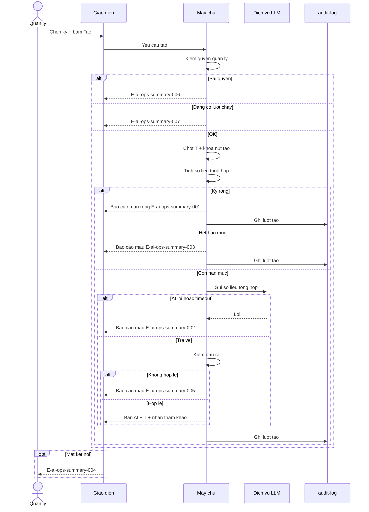
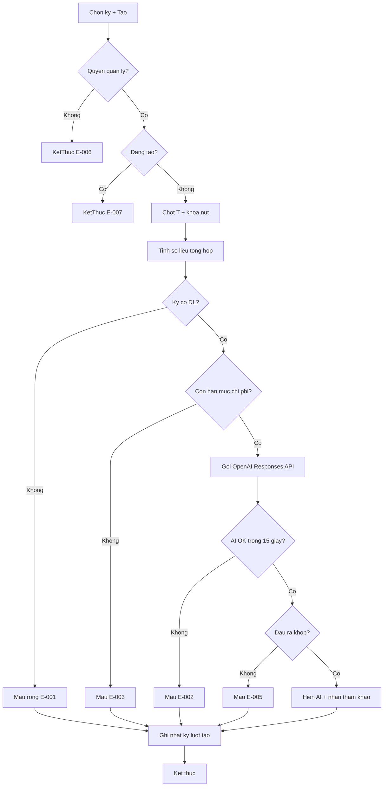
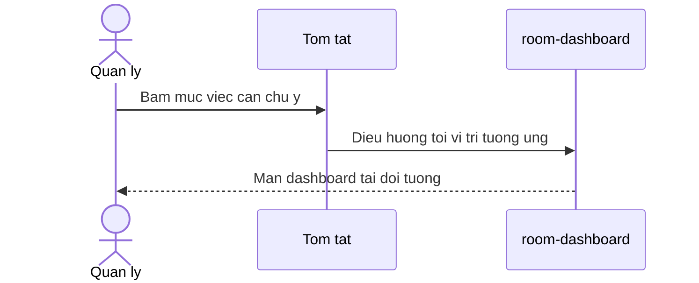

# ai-ops-summary — Flows

## Flow: Tao tom tat van hanh

**Trigger**: Quan ly bam Tao tom tat  
**Related UC**: [[../usecases/uc-tao-tom-tat-van-hanh.md]]  
**Related FR**: FR-ai-ops-summary-001 den FR-ai-ops-summary-010, FR-ai-ops-summary-014  
**Related E**: E-ai-ops-summary-001 den E-ai-ops-summary-007

## Flow: Dieu phoi viec can chu y

**Related UC**: [[../usecases/uc-dieu-phoi-viec-can-chu-y.md]]  
**Related FR**: FR-ai-ops-summary-012

