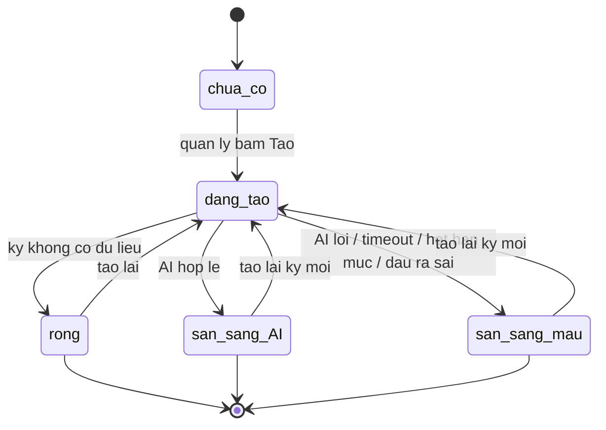
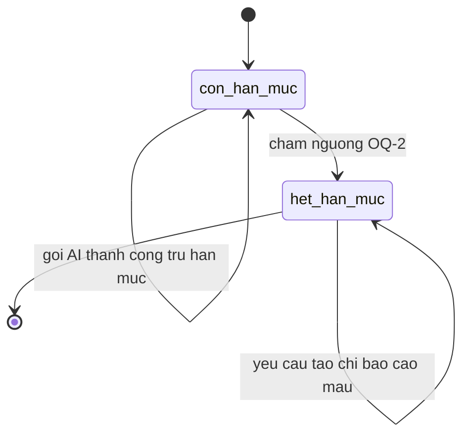

# ai-ops-summary — States

## State: BanTomTatKy

**Related entity**: BanTomTatKy  
**Related UC**: [[../usecases/uc-tao-tom-tat-van-hanh.md]]  
**Related BR**: BR-ai-ops-summary-004, BR-ai-ops-summary-005, BR-ai-ops-summary-006

### Invalid transitions

| From | To | Why not |
|---|---|---|
| chua_co | san_sang_AI | Phai qua dang_tao va goi AI |
| dang_tao | san_sang_AI | Khong hop le neu dau ra sai — phai mau |
| san_sang_AI | rong | Khong chuyen nguoc sau khi da co noi dung |

## State: HanMucAI

**Related entity**: HanMucAI  
**Related FR**: FR-ai-ops-summary-009  
**Note**: Hinh thuc va nguong — `spec.md#OQ-2` (khong bia so).

### Invalid transitions

| From | To | Why not |
|---|---|---|
| het_han_muc | con_han_muc | MVP khong mo ta nap lai trong feature nay |
