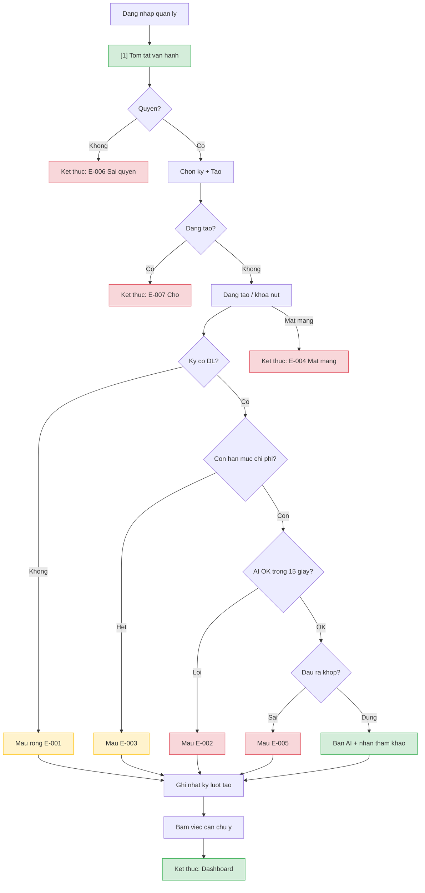

# ai-ops-summary — User Flow

> Spec: man quan ly tren web dashboard; `primary_device: mobile` theo batch.

## 1. User Flow (tổng)

## 2. Danh sách màn hình

| [#] | Slug | Màn hình | Mục đích | Thuộc flow |
|-----|------|----------|----------|------------|
| 1 | tom-tat-van-hanh | Tom tat van hanh | Chon ky, tao, xem AI/mau, viec can chu y | tao-tom-tat, dieu-phoi, xem-lai |

## 3. Danh sách flow

| Flow-slug | Tên flow | Màn hình gồm | Cases phủ |
|-----------|----------|--------------|-----------|
| tao-tom-tat | Tao tom tat | tom-tat-van-hanh | happy AI, mau, rong, han muc, timeout, mat mang, concurrent |
| dieu-phoi | Dieu phoi viec can chu y | tom-tat-van-hanh | happy → dashboard |
| xem-lai | Xem lai ban gan nhat | tom-tat-van-hanh | phu thuoc OQ-4 |

## 3.5. Chuyển màn (transitions)

| Từ màn [#] | Đến màn [#] | Trigger | Điều kiện |
|-----------|------------|---------|-----------|
| Tom tat [1] | Dashboard (feature khac) | Bam muc viec can chu y | FR-ai-ops-summary-012 |

## 4. Open Questions

* [ ] OQ-1 … OQ-5 → `srs/ai-ops-summary-spec.md`
