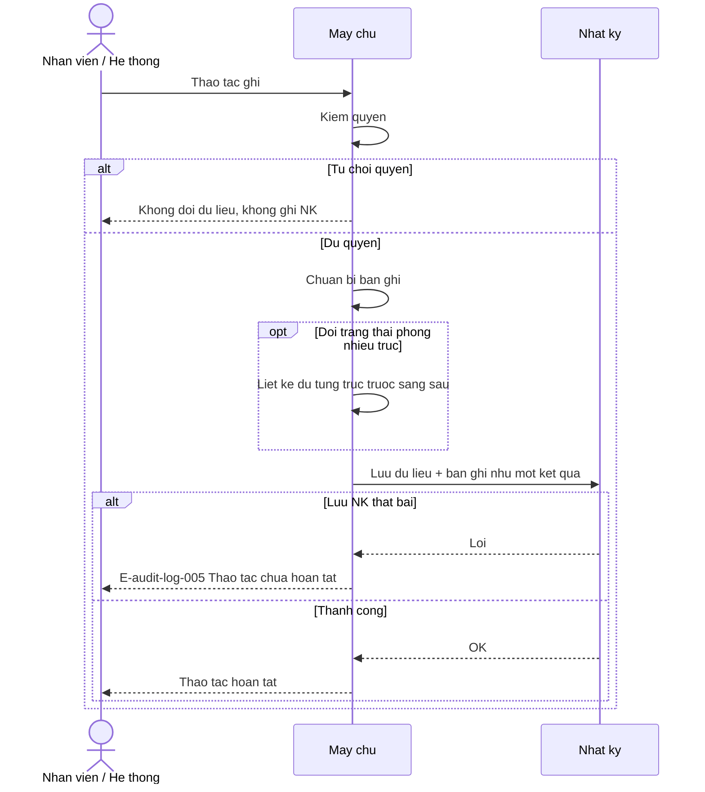
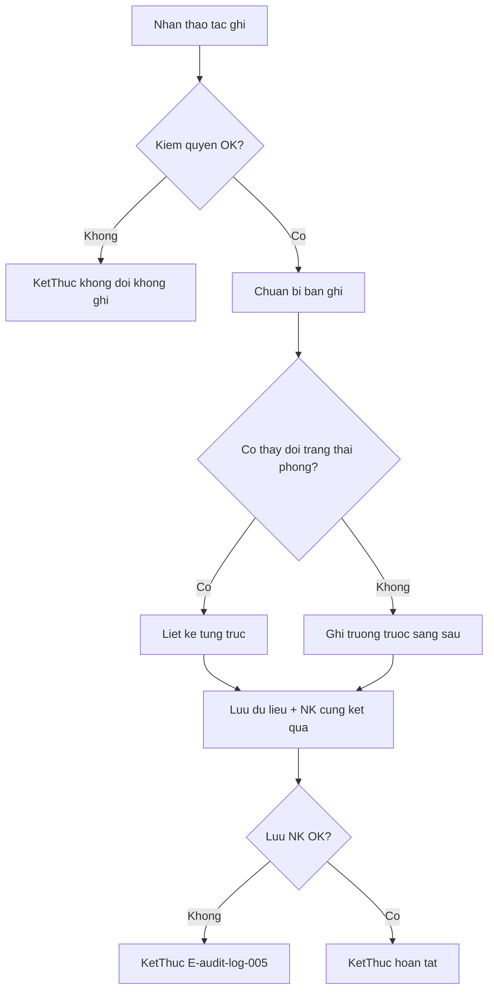
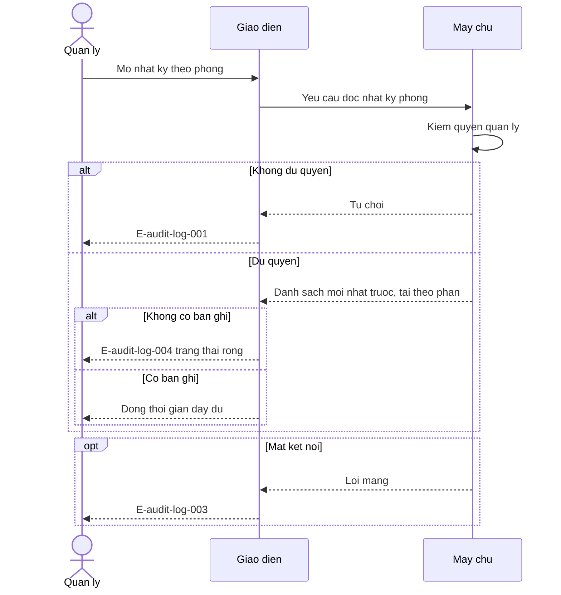
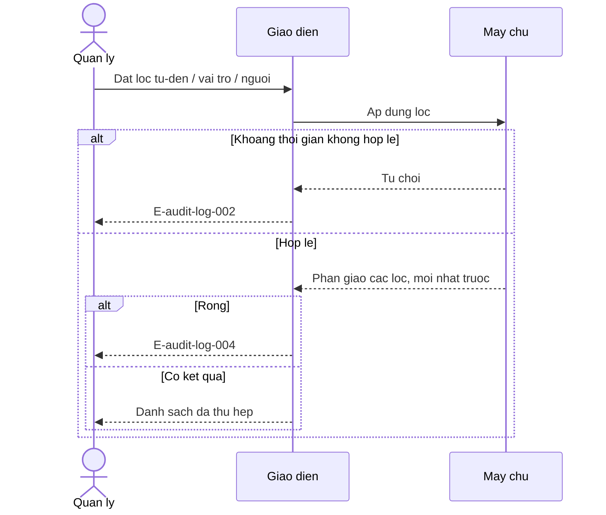
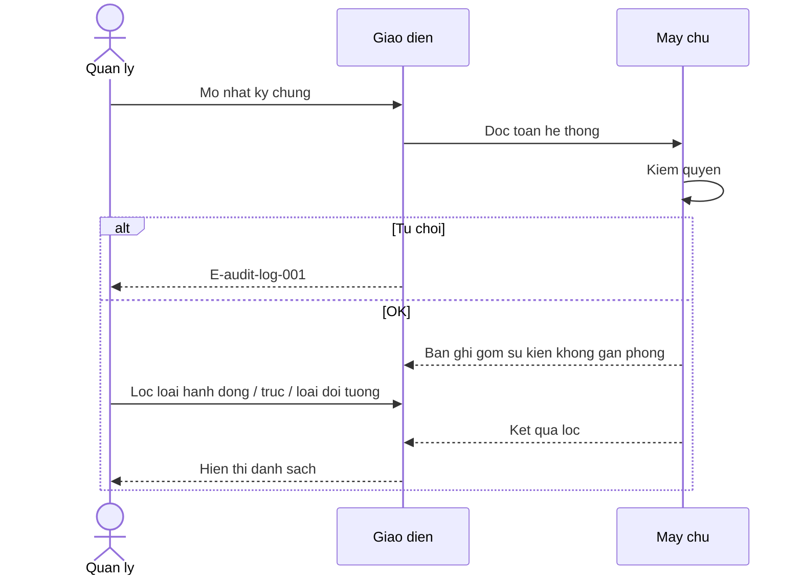

# audit-log — Flows

## Flow: Ghi bản ghi nhật ký

**Trigger**: Thao tác ghi đã kiểm quyền sẵn sàng lưu  
**Related UC**: [[../usecases/uc-ghi-ban-ghi-nhat-ky.md]]  
**Related FR**: FR-audit-log-001, FR-audit-log-002, FR-audit-log-003, FR-audit-log-004, FR-audit-log-006  
**Related E**: E-audit-log-005

## Flow: Xem nhật ký theo phòng

**Trigger**: Quản lý mở nhật ký một phòng  
**Related UC**: [[../usecases/uc-xem-nhat-ky-theo-phong.md]]  
**Related FR**: FR-audit-log-007, FR-audit-log-009, FR-audit-log-011  
**Related E**: E-audit-log-001, E-audit-log-003, E-audit-log-004

## Flow: Lọc nhật ký

**Trigger**: Quản lý đặt lọc thời gian / vai trò / người  
**Related UC**: [[../usecases/uc-loc-nhat-ky.md]]  
**Related FR**: FR-audit-log-008, FR-audit-log-010  
**Related E**: E-audit-log-002, E-audit-log-003, E-audit-log-004

## Flow: Xem nhật ký chung (P1)

**Trigger**: Quản lý mở nhật ký toàn hệ thống  
**Related UC**: [[../usecases/uc-xem-nhat-ky-chung.md]]  
**Related FR**: FR-audit-log-010  
**Related E**: E-audit-log-001, E-audit-log-003, E-audit-log-004

