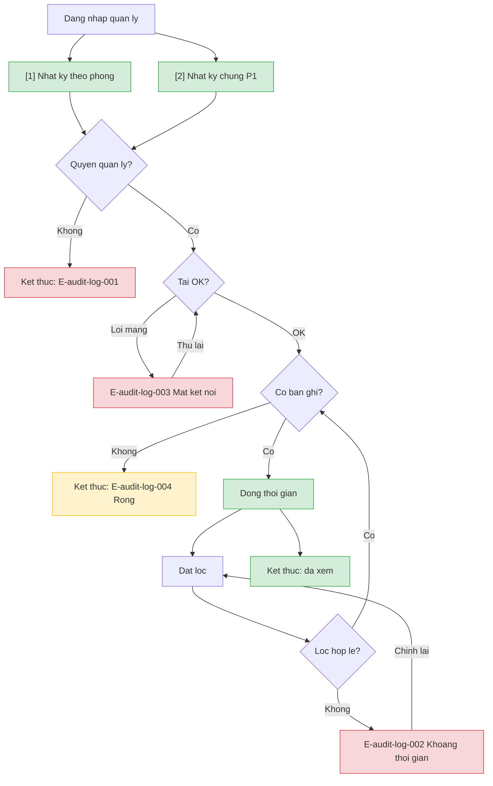

# audit-log — User Flow

> Nguồn chia flow DUY NHẤT. Spec: màn nhật ký cho quản lý (web); `primary_device: mobile` theo batch. Mobile nhân viên không có màn nhật ký v1.

## 1. User Flow (tổng)

## 2. Danh sách màn hình

| [#] | Slug | Màn hình | Mục đích | Thuộc flow |
|-----|------|----------|----------|------------|
| 1 | nhat-ky-theo-phong | Nhật ký theo phòng | Dòng thời gian bản ghi một phòng; lọc thời gian/vai trò/người | xem-theo-phong, loc-nhat-ky |
| 2 | nhat-ky-chung | Nhật ký chung | Toàn hệ thống gồm sự kiện không gắn phòng; lọc mở rộng | xem-nhat-ky-chung |

## 3. Danh sách flow

| Flow-slug | Tên flow | Màn hình gồm | Cases phủ |
|-----------|----------|--------------|-----------|
| xem-theo-phong | Xem nhật ký theo phòng | nhat-ky-theo-phong | happy, error quyền/mạng, empty |
| loc-nhat-ky | Lọc nhật ký | nhat-ky-theo-phong, nhat-ky-chung | happy, E-002, empty |
| xem-nhat-ky-chung | Xem nhật ký chung | nhat-ky-chung | happy P1, error, empty |

## 3.5. Chuyển màn (transitions)

| Từ màn [#] | Đến màn [#] | Trigger | Điều kiện |
|-----------|------------|---------|-----------|
| — | Nhật ký theo phòng [1] | Mở từ chi tiết phòng | Vai trò quản lý |
| — | Nhật ký chung [2] | Mở mục Nhật ký chung | Vai trò quản lý; P1 |

## 4. Open Questions

* [ ] OQ-1 → `srs/audit-log-spec.md#OQ-1`
* [ ] OQ-2 → `srs/audit-log-spec.md#OQ-2`
