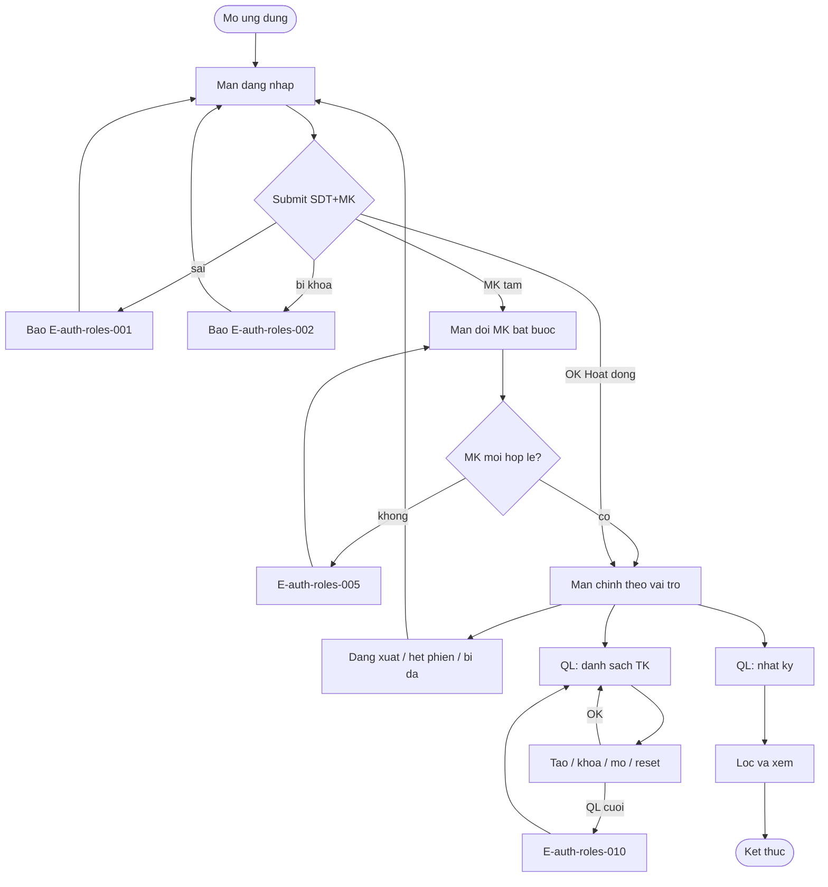

# Auth Roles — User Flow

## 1. User Flow (tổng)

## 2. Chia flow

| Flow slug | Screens | Use cases | Ghi chú |
|---|---|---|---|
| dang-nhap | login, force-change-password, home | uc-dang-nhap, uc-doi-mat-khau | P0 |
| quan-ly-tai-khoan | account-list, account-form, temp-password-once | uc-quan-ly-tai-khoan | P0 |
| xem-nhat-ky | audit-filter, audit-list | uc-xem-nhat-ky | P1 |

## 3. Open Questions (ref)

- OQ-1 ngưỡng hiệu năng đăng nhập — xem `srs/auth-roles-spec.md#OQ-1` (chưa chốt).
- OQ-2, OQ-3 đã resolved — không mở lại.

