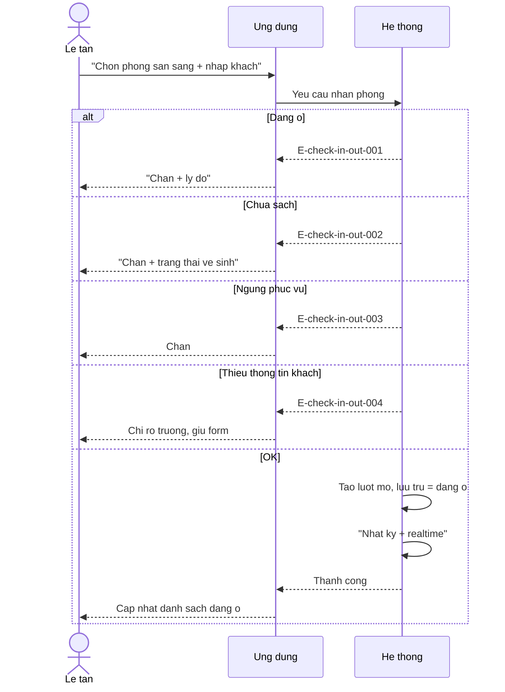
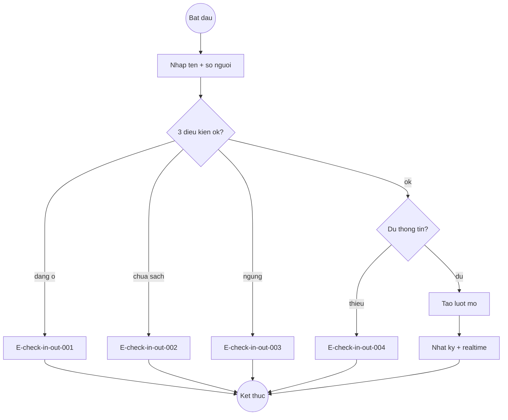
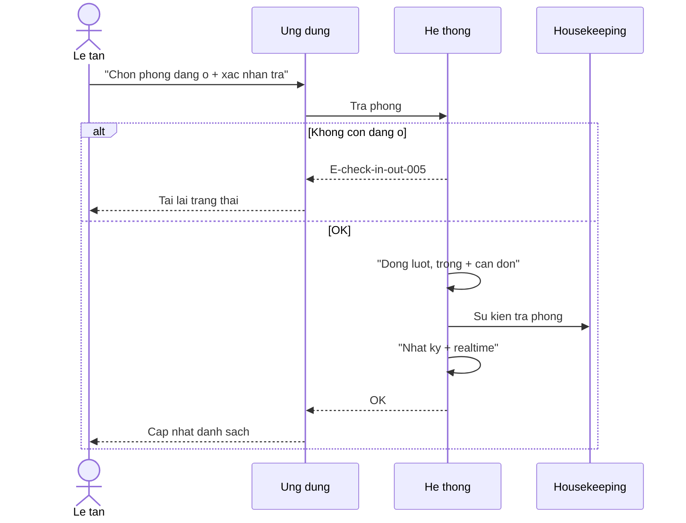
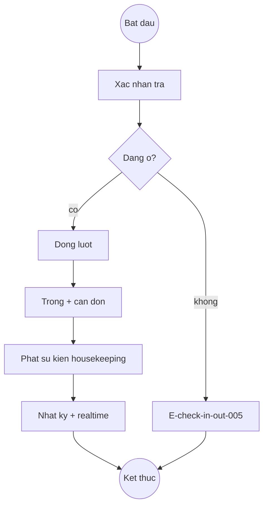
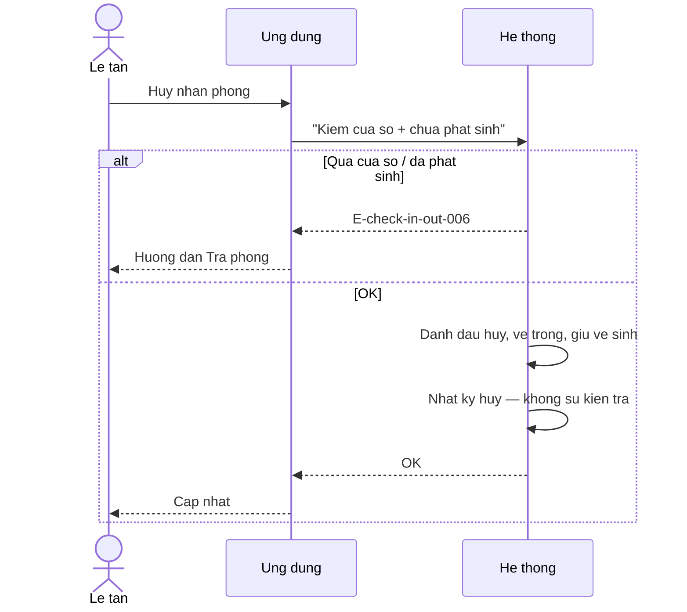
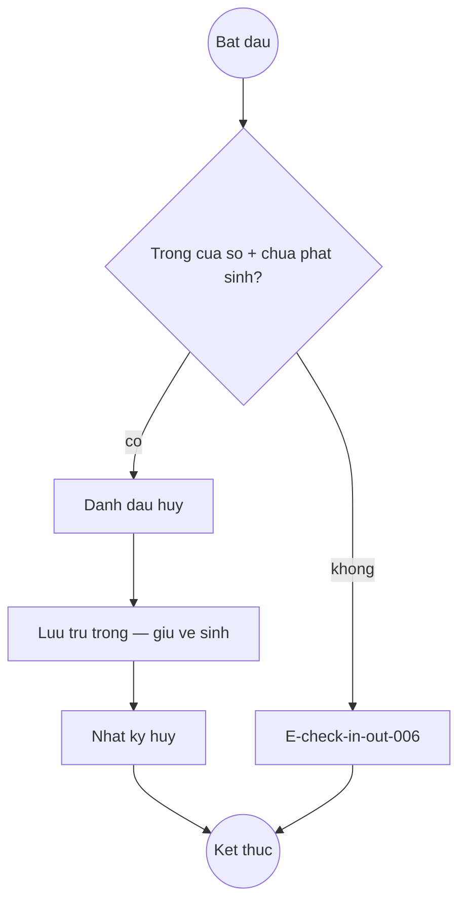

# Check-in-out — Flows

## Flow: Nhan phong
**Trigger**: Le tan xac nhan nhan phong
**Related UC**: [[../usecases/uc-nhan-phong.md]]
**Related FR**: FR-check-in-out-001, FR-check-in-out-002, FR-check-in-out-003
**Related E**: E-check-in-out-001, E-check-in-out-002, E-check-in-out-003, E-check-in-out-004

## Flow: Tra phong
**Trigger**: Le tan xac nhan tra phong
**Related UC**: [[../usecases/uc-tra-phong.md]]
**Related FR**: FR-check-in-out-004
**Related E**: E-check-in-out-005

## Flow: Huy nhan phong
**Trigger**: Le tan huy nhan trong cua so ngan
**Related UC**: [[../usecases/uc-huy-nhan-phong.md]]
**Related FR**: FR-check-in-out-006
**Related E**: E-check-in-out-006

