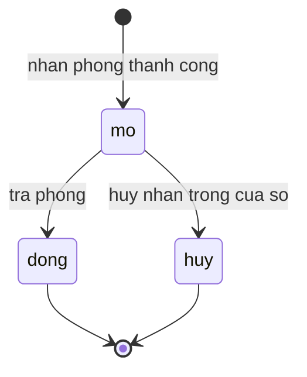
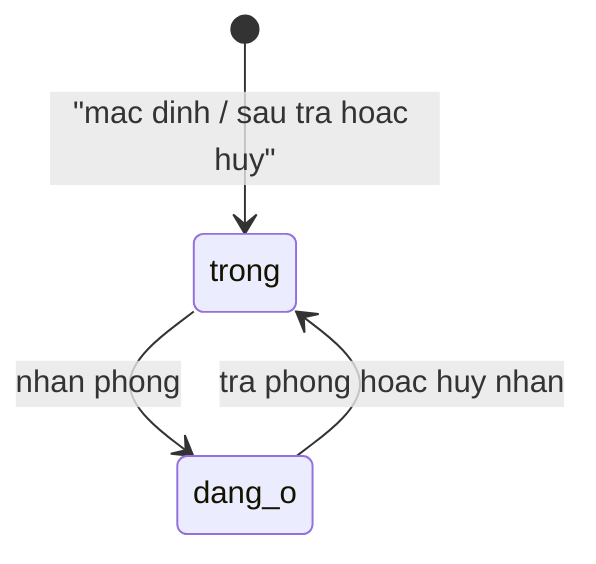

# Check-in-out — States

## State: LuotLuuTru
**Related entity**: LuotLuuTru
**Related UC**: [[../usecases/uc-nhan-phong.md]], [[../usecases/uc-tra-phong.md]], [[../usecases/uc-huy-nhan-phong.md]]

### Invalid transitions

| From | To | Why not |
|---|---|---|
| dong | mo | Luot da dong khong mo lai — nhan moi tao luot moi |
| huy | dong | Huy khong phat su kien tra / khong dong nhu tra |
| dong | huy | Khong huy sau khi da tra |

## State: Phong — truc luu tru (so huu boi feature nay)
**Related entity**: Phong.truc_luu_tru

### Invalid transitions

| From | To | Why not |
|---|---|---|
| dang_o | dang_o | Toi da 1 luot mo / phong (FR-check-in-out-008) |
