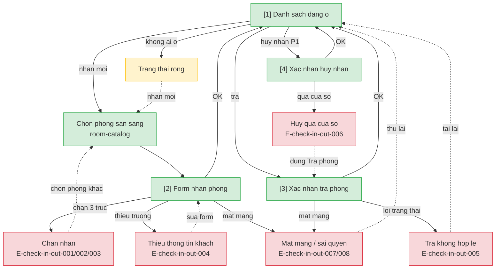

# Check-in-out — User Flow

> Batch-authorized by Devin (Tang 2→4, bo L1/HARD STOP).

## 1. User Flow (tong)

## 2. Danh sach man hinh

| [#] | Slug | Man hinh | Muc dich | Thuoc flow |
|-----|------|----------|----------|------------|
| 1 | occupied-list | Danh sach dang o | Xem phong+khach+moc nhan; chon tra/huy | view-occupied, check-in, check-out, cancel-check-in |
| 2 | check-in-form | Form nhan phong | Ten khach + so nguoi (+ ghi chu/ngay P1) | check-in |
| 3 | check-out-confirm | Xac nhan tra phong | Xac nhan dong luot | check-out |
| 4 | cancel-check-in-confirm | Xac nhan huy nhan | Huy trong cua so ngan | cancel-check-in |

## 3. Muc chia flow

| Flow-slug | Ten flow | Man hinh gom | Cases phu |
|-----------|----------|--------------|-----------|
| view-occupied | Xem danh sach dang o | occupied-list | happy, edge (rong) |
| check-in | Nhan phong | occupied-list → check-in-form | happy, error (3 truc, thieu thong tin) |
| check-out | Tra phong | occupied-list → check-out-confirm | happy, error (trang thai), edge (ngung + dang o) |
| cancel-check-in | Huy nhan phong | occupied-list → cancel-check-in-confirm | happy, error (qua cua so) |

## 3.5. Chuyen man (transitions)

| Tu man [#] | Den man [#] | Trigger | Dieu kien |
|-----------|------------|---------|-----------|
| Danh sach dang o [1] | Form nhan [2] | Nhan phong (tu phong san sang) | Le tan |
| Form nhan [2] | Danh sach [1] | Luu OK / Huy | — |
| Danh sach [1] | Xac nhan tra [3] | Tra phong | Co luot mo |
| Xac nhan tra [3] | Danh sach [1] | Xac nhan / Huy | — |
| Danh sach [1] | Xac nhan huy [4] | Huy nhan | P1, trong cua so |
| Xac nhan huy [4] | Danh sach [1] | Xac nhan / Huy | — |

## 4. Open Questions

- [ ] `spec.md#OQ-1` — Thong tin khach toi thieu
- [ ] `spec.md#OQ-2` — Cua so huy nhan / chua phat sinh
- [ ] `spec.md#OQ-3` — Ghi chu tinh trang khi tra
- [ ] `spec.md#OQ-4` — Le tan xem lich su luot da dong
