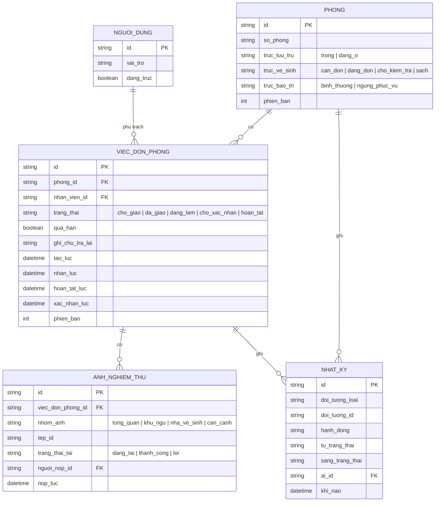

# housekeeping — ERD

> "Sẵn sàng" = trống + sạch + bình thường — composite suy ra, không phải trường lưu (BR-housekeeping-003). Nguồn danh sách đang trực — OQ-1.

> Ảnh nghiệm thu thuộc một lần dọn, không phải album cố định của phòng. Bộ tối thiểu có một ảnh `tong_quan`, `khu_ngu` và `nha_ve_sinh`; `can_canh` chỉ dùng khi có bất thường (BR-housekeeping-006).
