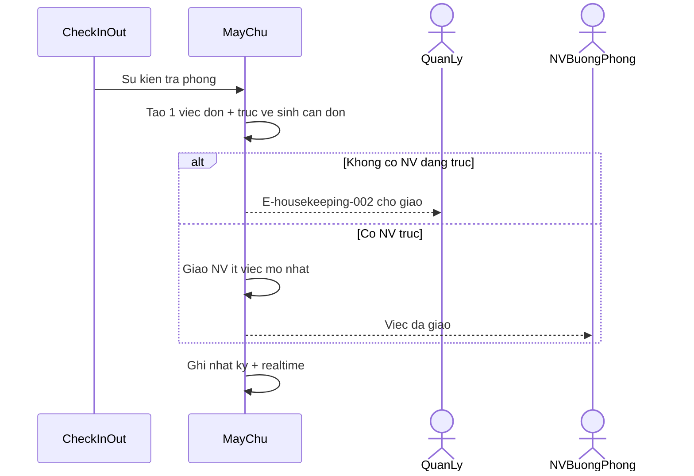
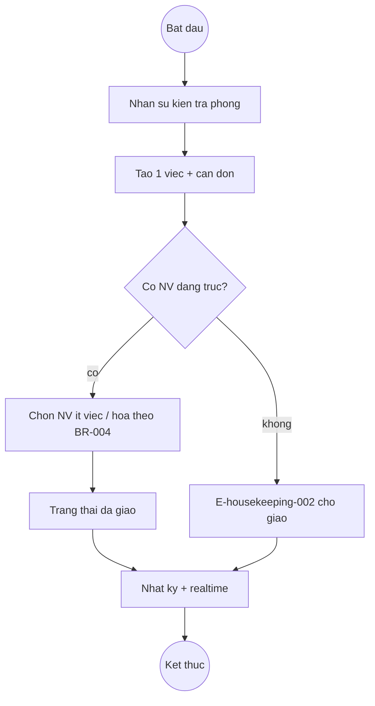
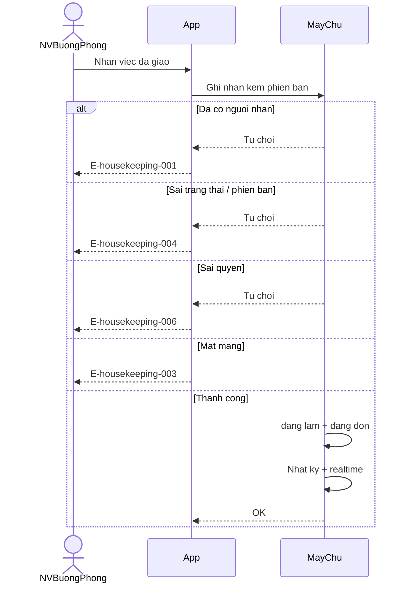
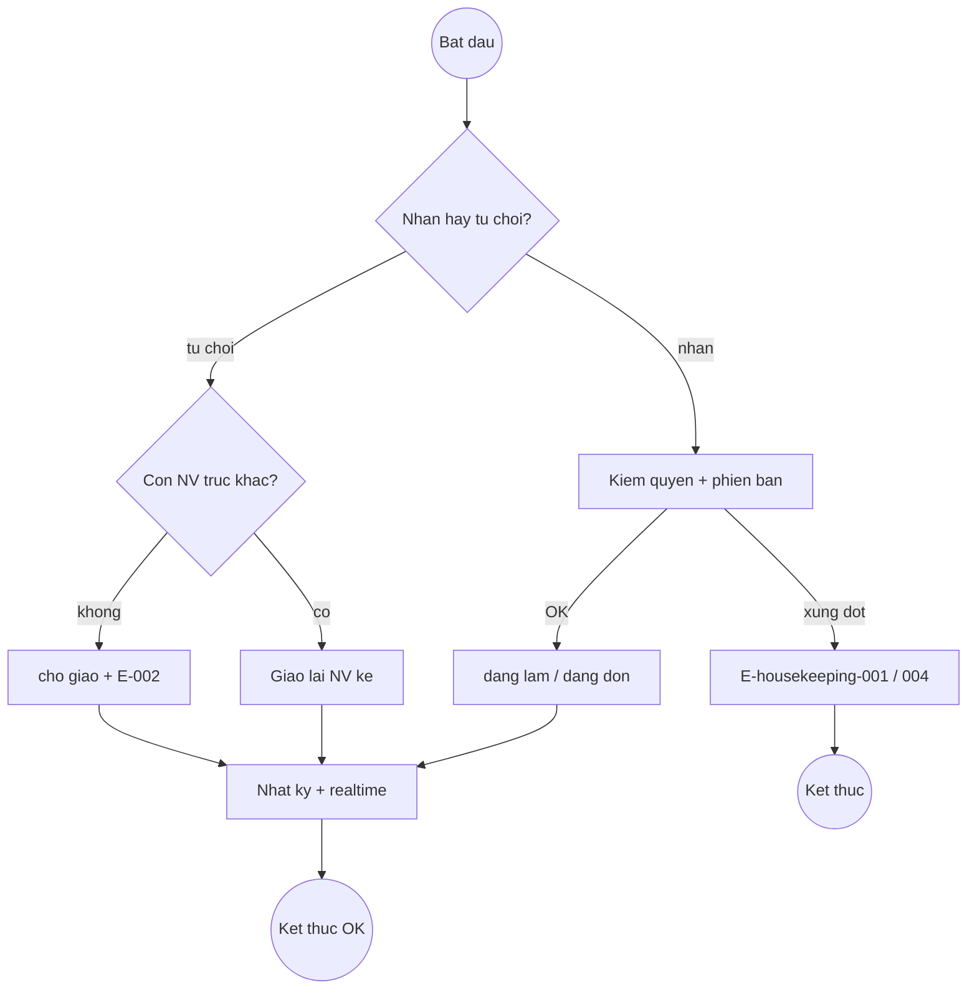
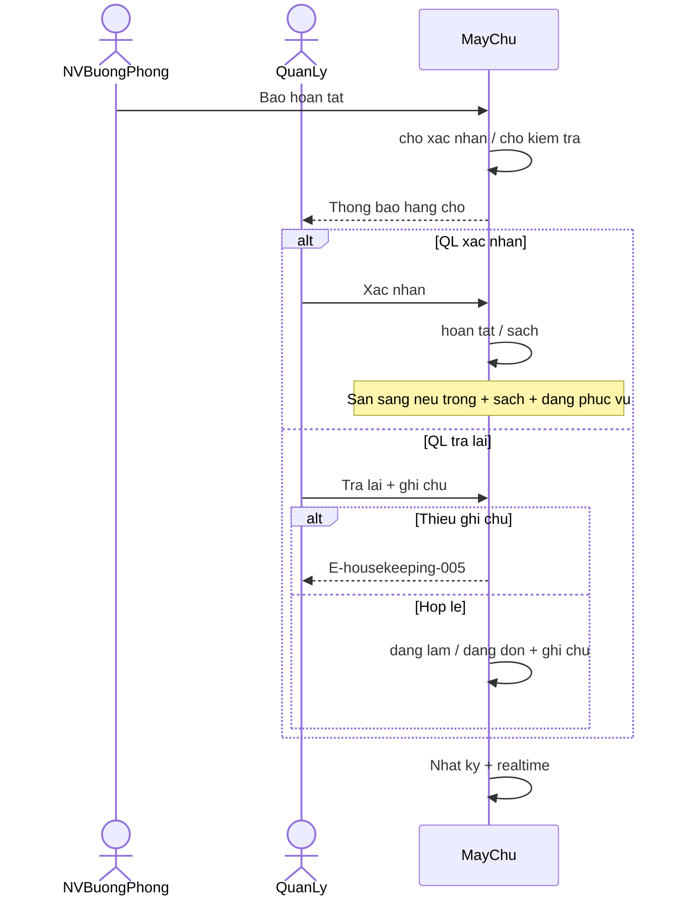
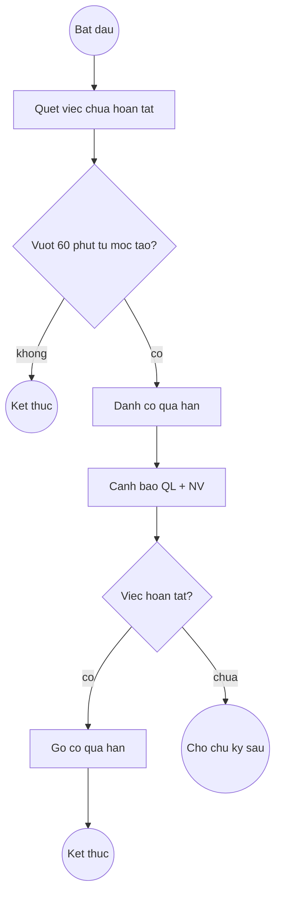

# housekeeping — Flows

## Flow: Tạo và giao việc sau trả phòng (Sequence)

**Trigger**: Sự kiện trả phòng
**Related UC**: [[../usecases/uc-tao-giao-viec-sau-tra-phong.md]]
**Related FR**: FR-housekeeping-001, FR-housekeeping-002, FR-housekeeping-003, FR-housekeeping-013
**Related E**: E-housekeeping-002

## Flow: Tạo và giao việc (Activity)

**Related E**: E-housekeeping-002

## Flow: Nhận / từ chối việc (Sequence)

**Related UC**: [[../usecases/uc-nhan-tu-choi-viec.md]]
**Related FR**: FR-housekeeping-004, FR-housekeeping-011, FR-housekeeping-012
**Related E**: E-housekeeping-001, E-housekeeping-003, E-housekeeping-004, E-housekeeping-006

## Flow: Nhận / từ chối (Activity)

## Flow: Báo hoàn tất → xác nhận / trả lại (Sequence)

**Related UC**: [[../usecases/uc-bao-hoan-tat.md]], [[../usecases/uc-xac-nhan-tra-lai.md]]
**Related FR**: FR-housekeeping-005, FR-housekeeping-006, FR-housekeeping-007
**Related E**: E-housekeeping-005

## Flow: Cảnh báo quá hạn (Activity)

**Related UC**: [[../usecases/uc-canh-bao-qua-han.md]]
**Related FR**: FR-housekeeping-008
**Related BR**: BR-housekeeping-002

