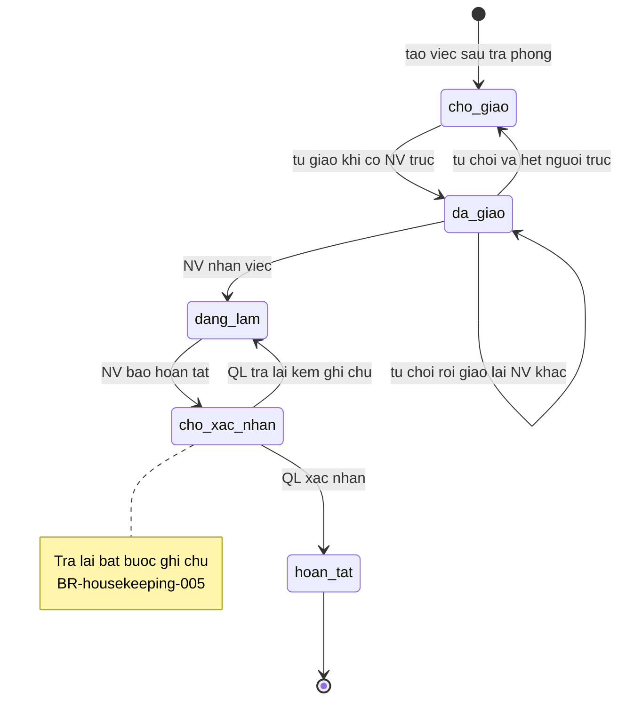
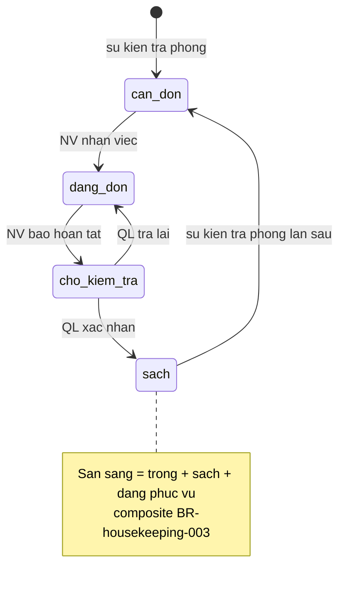

# housekeeping — States

## State: ViecDonPhong

**Related entity**: ViecDonPhong (khớp ERD `srs/housekeeping-erd.md`)
**Related UC**: [[../usecases/uc-tao-giao-viec-sau-tra-phong.md]], [[../usecases/uc-nhan-tu-choi-viec.md]], [[../usecases/uc-bao-hoan-tat.md]], [[../usecases/uc-xac-nhan-tra-lai.md]]
**Related BR**: BR-housekeeping-001, BR-housekeeping-002, BR-housekeeping-005

### Invalid transitions

| From | To | Why not |
|---|---|---|
| hoan_tat | dang_lam | Việc đã hoàn tất không mở lại |
| cho_giao | cho_xac_nhan | Phải qua nhận / đang làm |
| dang_lam | hoan_tat | Phải qua xác nhận quản lý (BR-housekeeping-001) |

## State: TrucVeSinhPhong

**Related entity**: Phong.truc_ve_sinh
**Related UC**: [[../usecases/uc-tao-giao-viec-sau-tra-phong.md]], [[../usecases/uc-nhan-tu-choi-viec.md]], [[../usecases/uc-bao-hoan-tat.md]], [[../usecases/uc-xac-nhan-tra-lai.md]]
**Related BR**: BR-housekeeping-001, BR-housekeeping-003

### Invalid transitions

| From | To | Why not |
|---|---|---|
| can_don | sach | Phải qua dọn + xác nhận quản lý |
| cho_kiem_tra | can_don | Không nhảy về cần dọn khi trả lại — về đang dọn |
