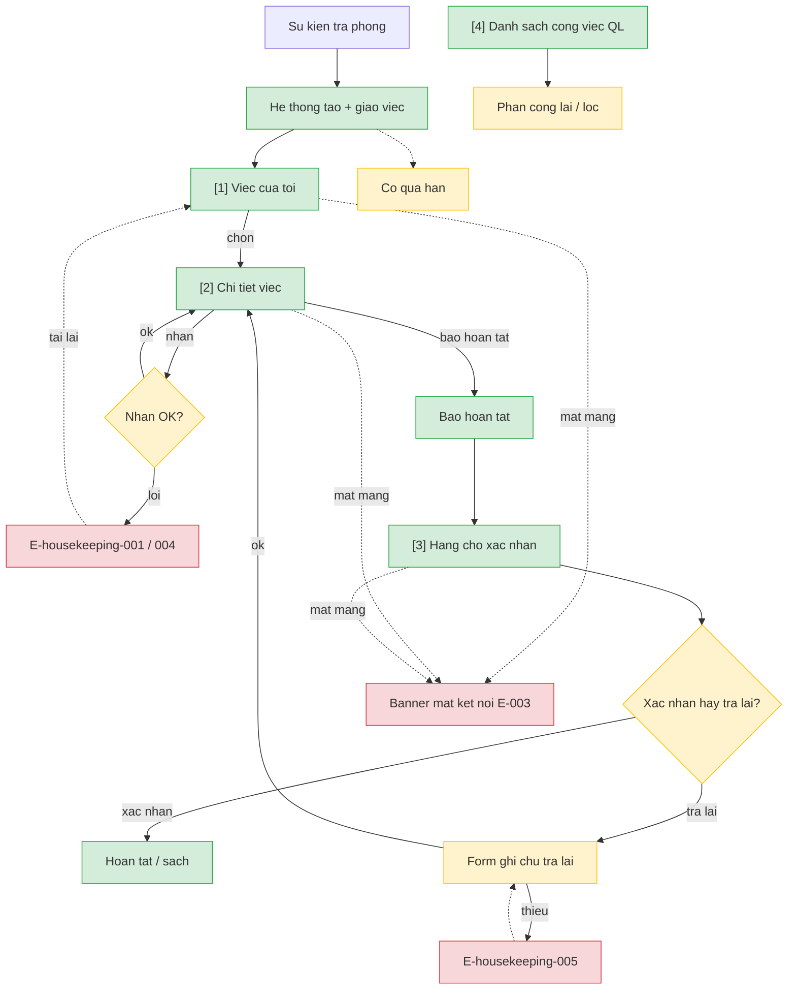

# housekeeping — User Flow

> Nguồn chia flow DUY NHẤT. Batch-authorized by Devin (Tầng 2→4, no L1/HARD STOP).

## 1. User Flow (tổng)

## 2. Danh sách màn hình

| [#] | Slug | Màn hình | Mục đích | Thuộc flow |
|-----|------|----------|----------|------------|
| 1 | viec-cua-toi | Việc của tôi | NV xem việc giao/đang làm; nhận/từ chối; cờ quá hạn | xu-ly-viec |
| 2 | chi-tiet-viec | Chi tiết công việc | Nhận/từ chối/báo hoàn tất; xem ghi chú trả lại | xu-ly-viec, xac-nhan |
| 3 | hang-cho-xac-nhan | Hàng chờ xác nhận | QL xác nhận / trả lại | xac-nhan |
| 4 | danh-sach-cong-viec | Danh sách công việc | QL lọc + phân công lại + quá hạn | quan-ly-viec |

## 3. Danh sách flow

| Flow-slug | Tên flow | Màn hình gồm | Cases phủ |
|-----------|----------|--------------|-----------|
| xu-ly-viec | NV nhận / từ chối / báo hoàn tất | viec-cua-toi → chi-tiet-viec | happy, error (xung đột, mất mạng), edge (từ chối) |
| xac-nhan | QL xác nhận / trả lại | hang-cho-xac-nhan, chi-tiet-viec | happy, error (thiếu ghi chú) |
| quan-ly-viec | Lọc + phân công lại | danh-sach-cong-viec | happy, edge (0 kết quả lọc) |

## 3.5. Chuyển màn (transitions)

| Từ màn [#] | Đến màn [#] | Trigger | Điều kiện |
|-----------|------------|---------|-----------|
| Việc của tôi [1] | Chi tiết [2] | Chọn một việc | — |
| Chi tiết [2] | Việc của tôi [1] | Nhận/từ chối/báo HT thành công hoặc Quay lại | — |
| Hàng chờ [3] | Chi tiết [2] | Chọn việc chờ xác nhận | — |
| Danh sách QL [4] | Chi tiết [2] | Chọn việc để phân công lại | — |

## 4. Open Questions

> Canonical: `srs/housekeeping-spec.md` Mục 12 — chỉ ref.

- [ ] OQ-1: xem `spec.md#OQ-1` — Nguồn danh sách NV buồng phòng đang trực?
- [ ] OQ-2: xem `spec.md#OQ-2` — Cảnh báo quá hạn 1 lần hay lặp định kỳ?
- [ ] OQ-3: xem `spec.md#OQ-3` — Việc chờ xác nhận quá lâu có ngưỡng nhắc riêng?
