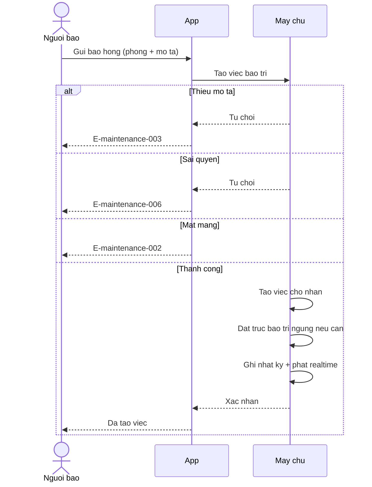
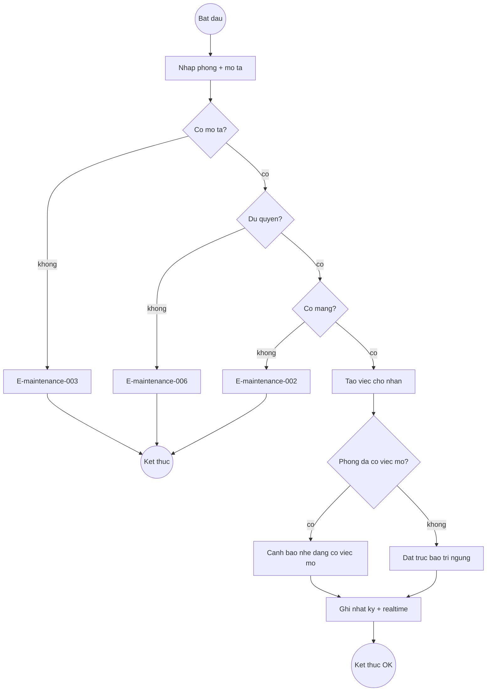
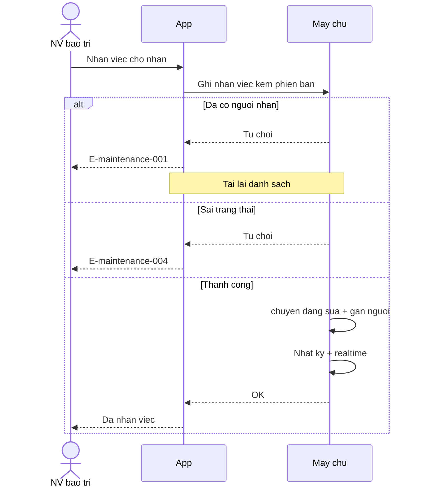
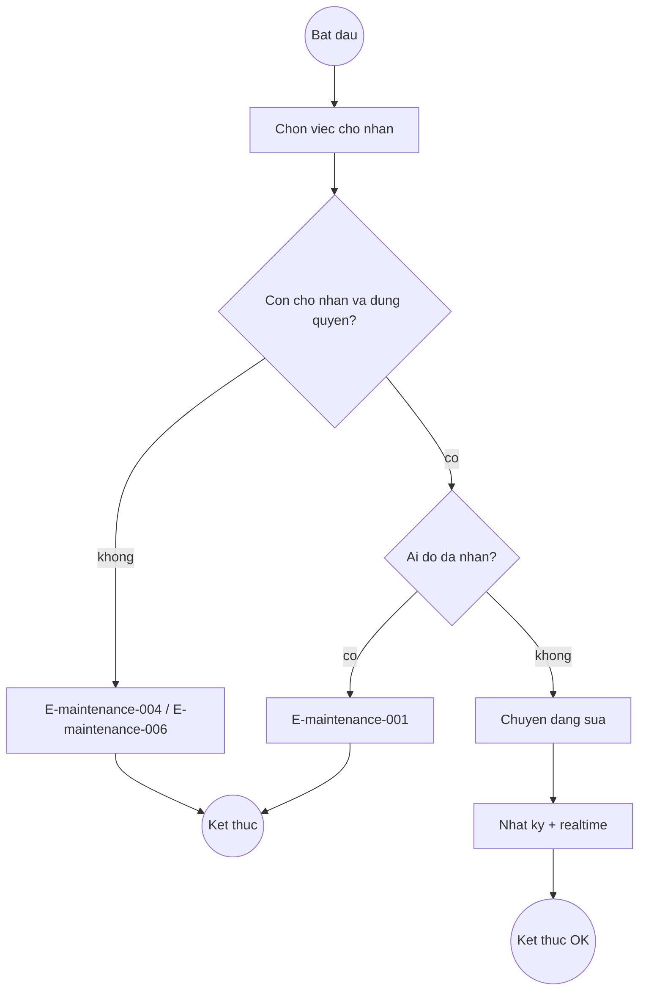
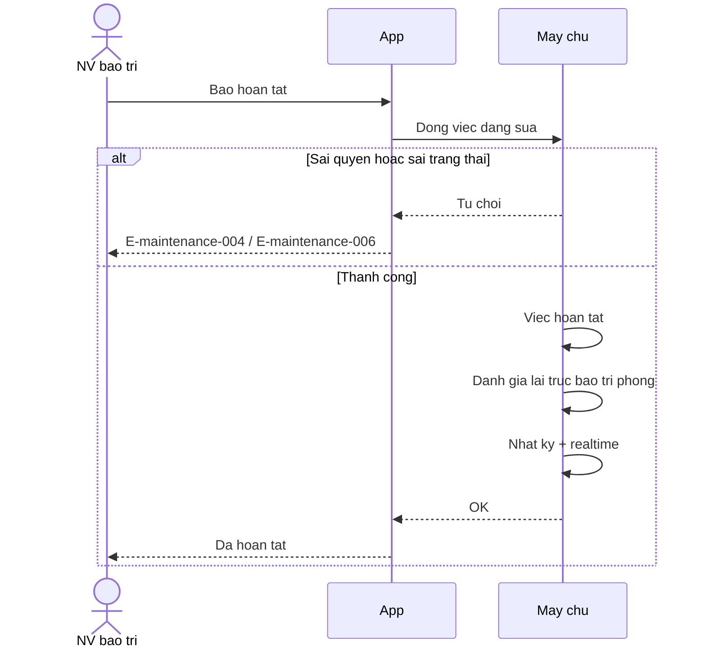
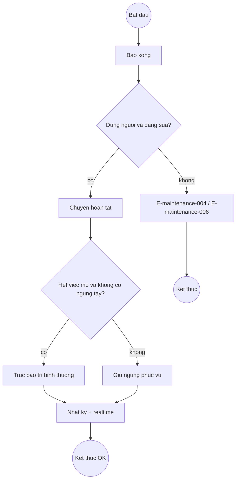
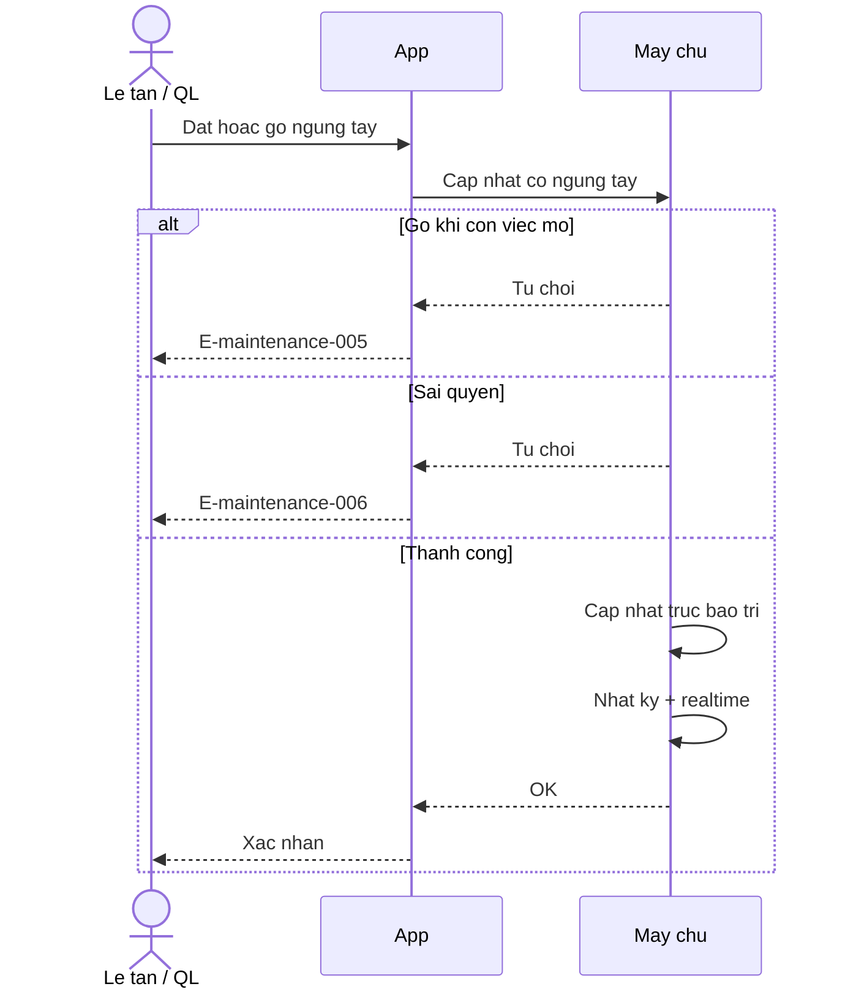
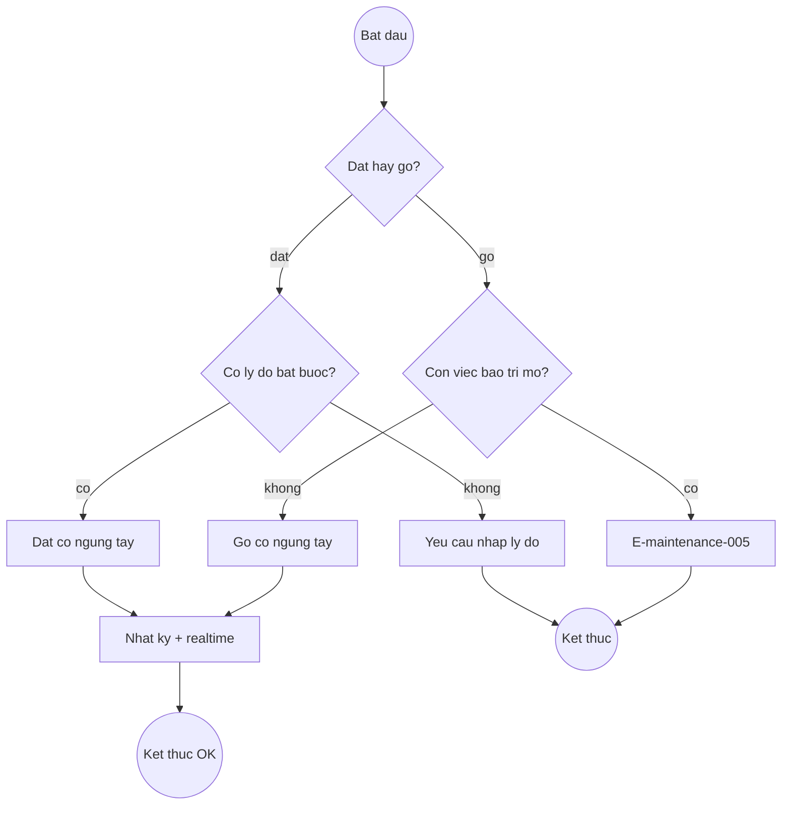

# maintenance — Flows

## Flow: Báo hỏng → tạo việc (Sequence)

**Trigger**: Người dùng gửi báo hỏng hợp lệ
**Related UC**: [[../usecases/uc-bao-hong.md]]
**Related FR**: FR-maintenance-001, FR-maintenance-002, FR-maintenance-008, FR-maintenance-011
**Related E**: E-maintenance-002, E-maintenance-003, E-maintenance-006

## Flow: Báo hỏng → tạo việc (Activity)

**Trigger**: Người dùng gửi báo hỏng
**Related UC**: [[../usecases/uc-bao-hong.md]]
**Related E**: E-maintenance-002, E-maintenance-003, E-maintenance-006

## Flow: Nhận việc (Sequence)

**Trigger**: NV bảo trì nhận việc "chờ nhận"
**Related UC**: [[../usecases/uc-nhan-viec.md]]
**Related FR**: FR-maintenance-004, FR-maintenance-011
**Related E**: E-maintenance-001, E-maintenance-002, E-maintenance-004, E-maintenance-006

## Flow: Nhận việc (Activity)

**Related E**: E-maintenance-001, E-maintenance-004

## Flow: Hoàn tất việc (Sequence)

**Related UC**: [[../usecases/uc-hoan-tat-viec.md]]
**Related FR**: FR-maintenance-003, FR-maintenance-005, FR-maintenance-011
**Related E**: E-maintenance-002, E-maintenance-004, E-maintenance-006

## Flow: Hoàn tất việc (Activity)

## Flow: Đặt/gỡ ngừng tay (Sequence)

**Related UC**: [[../usecases/uc-dat-go-ngung.md]]
**Related FR**: FR-maintenance-007, FR-maintenance-011
**Related E**: E-maintenance-002, E-maintenance-005, E-maintenance-006

## Flow: Đặt/gỡ ngừng tay (Activity)

