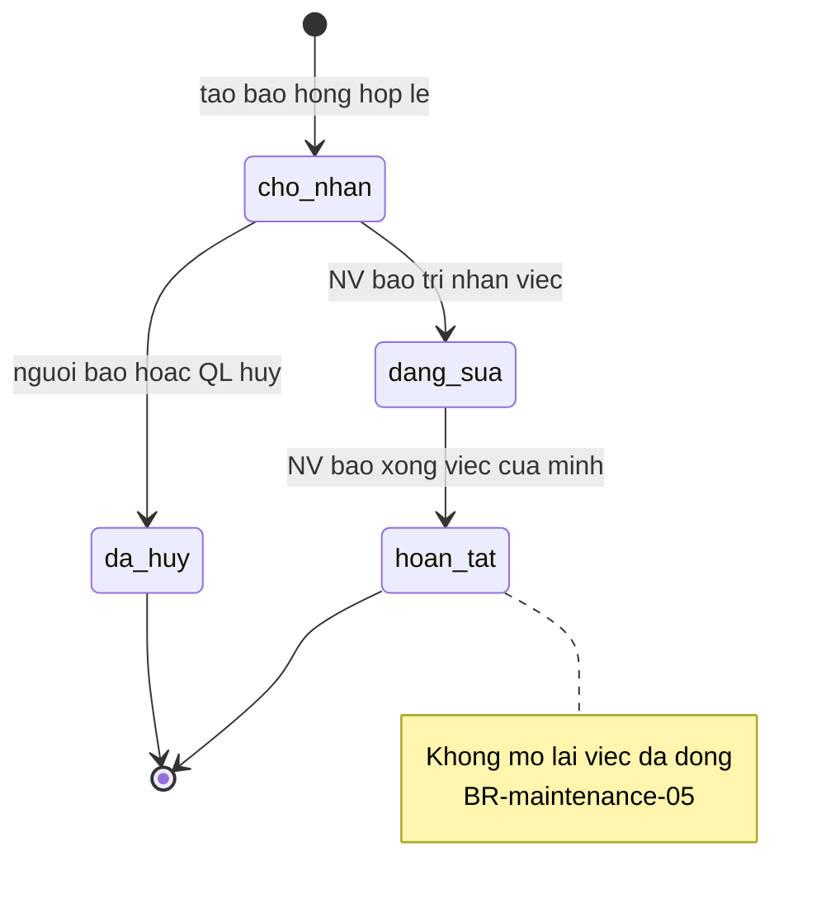
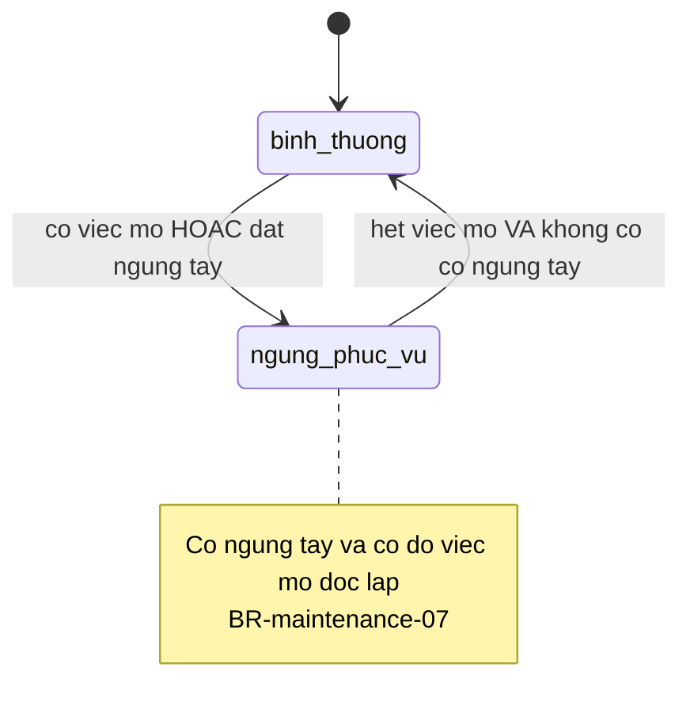

# maintenance — States

## State: ViecBaoTri

**Related entity**: ViecBaoTri (khớp ERD `srs/maintenance-erd.md`)
**Related UC**: [[../usecases/uc-bao-hong.md]], [[../usecases/uc-nhan-viec.md]], [[../usecases/uc-hoan-tat-viec.md]], [[../usecases/uc-huy-viec.md]]
**Related BR**: BR-maintenance-05

### Invalid transitions

| From | To | Why not |
|---|---|---|
| hoan_tat | cho_nhan | Việc đã đóng không mở lại (BR-maintenance-05) |
| da_huy | dang_sua | Việc đã hủy không mở lại |
| dang_sua | cho_nhan | Không trả về chờ nhận sau khi đã nhận |

## State: TrucBaoTriPhong

**Related entity**: Phong.truc_bao_tri
**Related UC**: [[../usecases/uc-bao-hong.md]], [[../usecases/uc-hoan-tat-viec.md]], [[../usecases/uc-dat-go-ngung.md]]
**Related BR**: BR-maintenance-01, BR-maintenance-07

### Invalid transitions

| From | To | Why not |
|---|---|---|
| ngung_phuc_vu | binh_thuong | Không chuyển khi còn việc mở hoặc còn cờ ngừng tay |
