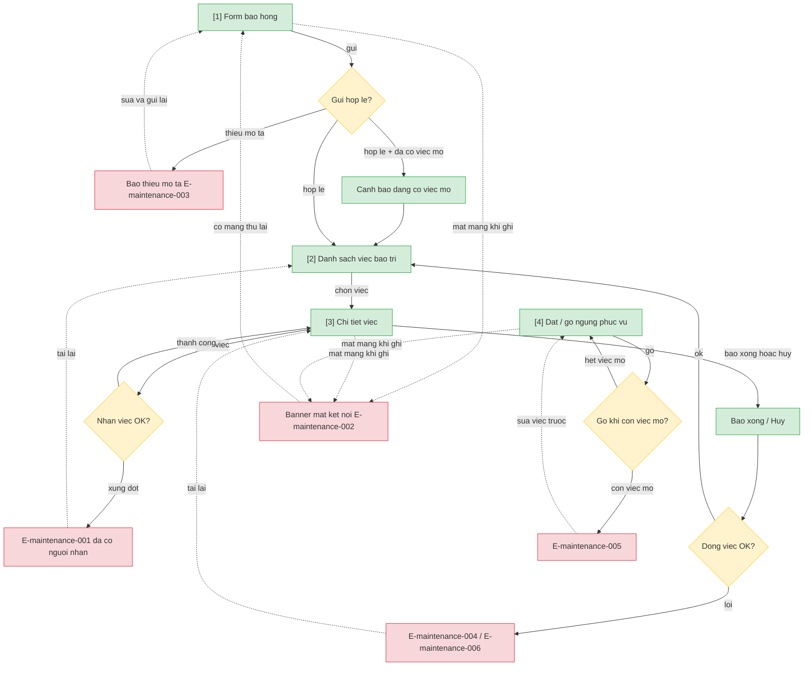

# maintenance — User Flow

> Nguồn chia flow DUY NHẤT. Batch-authorized by Devin (Tầng 2→4, no L1/HARD STOP).

## 1. User Flow (tổng)

> Phủ happy / error / edge. `[n]` = số màn hình đối chiếu Mục 2.

## 2. Danh sách màn hình

| [#] | Slug | Màn hình | Mục đích | Thuộc flow |
|-----|------|----------|----------|------------|
| 1 | form-bao-hong | Form báo hỏng | Chọn phòng + mô tả/vị trí, gửi báo hỏng | bao-hong |
| 2 | danh-sach-viec | Danh sách việc bảo trì | Xem/lọc việc chờ nhận/đang sửa/quá hạn | xu-ly-viec |
| 3 | chi-tiet-viec | Chi tiết việc | Nhận việc, báo xong, hủy | xu-ly-viec |
| 4 | dat-go-ngung | Đặt/gỡ ngừng phục vụ | Đặt tay kèm lý do; gỡ tay | dat-go-ngung |

## 3. Danh sách flow

| Flow-slug | Tên flow | Màn hình gồm | Cases phủ |
|-----------|----------|--------------|-----------|
| bao-hong | Báo hỏng | form-bao-hong | happy, error (thiếu mô tả, mất mạng), edge (đã có việc mở) |
| xu-ly-viec | Nhận / hoàn tất / hủy việc | danh-sach-viec → chi-tiet-viec | happy, error (xung đột nhận, sai trạng thái), edge (hủy chờ nhận) |
| dat-go-ngung | Đặt/gỡ ngừng tay | dat-go-ngung | happy, error (gỡ khi còn việc mở, mất mạng) |

## 3.5. Chuyển màn (transitions)

| Từ màn [#] | Đến màn [#] | Trigger | Điều kiện |
|-----------|------------|---------|-----------|
| Form báo hỏng [1] | Danh sách việc [2] | Gửi báo hỏng thành công | — |
| Danh sách việc [2] | Chi tiết việc [3] | Chọn một việc | — |
| Chi tiết việc [3] | Danh sách việc [2] | Nhận/báo xong/hủy thành công hoặc Quay lại | — |

## 4. Open Questions

> Chỉ ref — không tự trả lời. Canonical: `srs/maintenance-spec.md` Mục 14.

- [ ] OQ-1: xem `spec.md#OQ-1` — Ngưỡng "quá hạn" việc bảo trì + tần suất cảnh báo?
- [ ] OQ-2: xem `spec.md#OQ-2` — Cơ chế giao việc — tự nhận hay chỉ định từ đầu?
- [ ] OQ-3: xem `spec.md#OQ-3` — Việc trên phòng đang có khách — sửa giữa kỳ lưu trú hay chờ trả?
