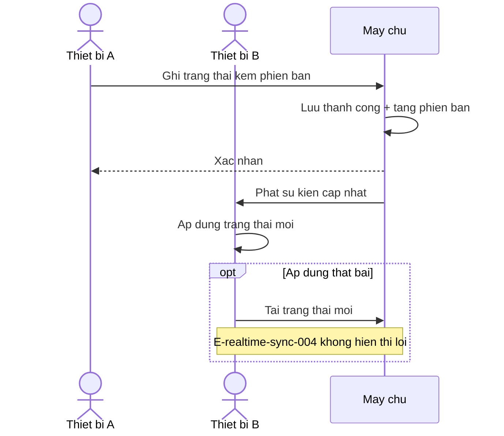
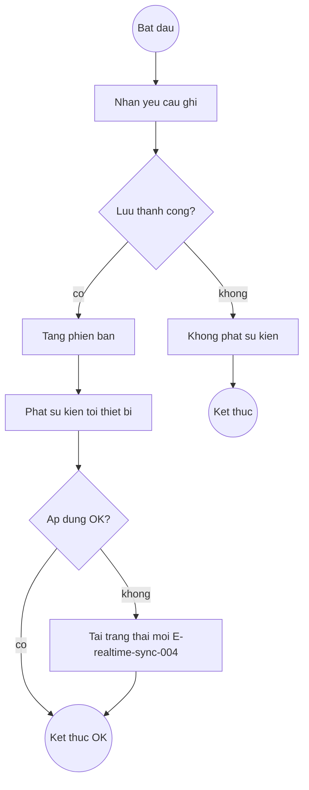
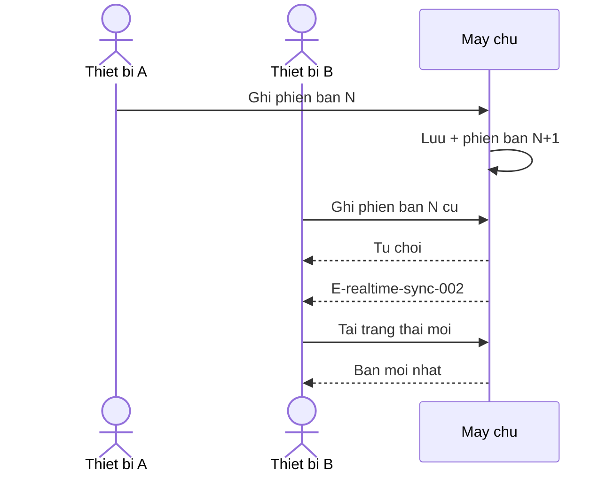
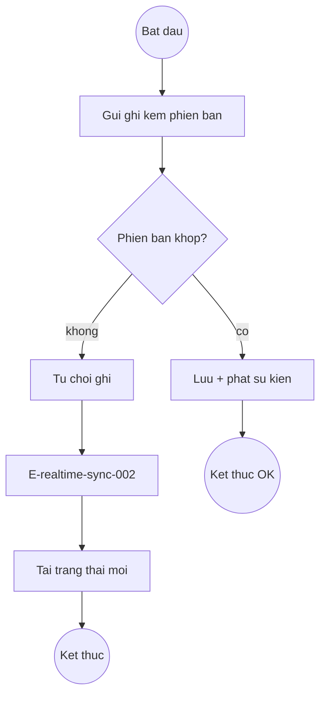
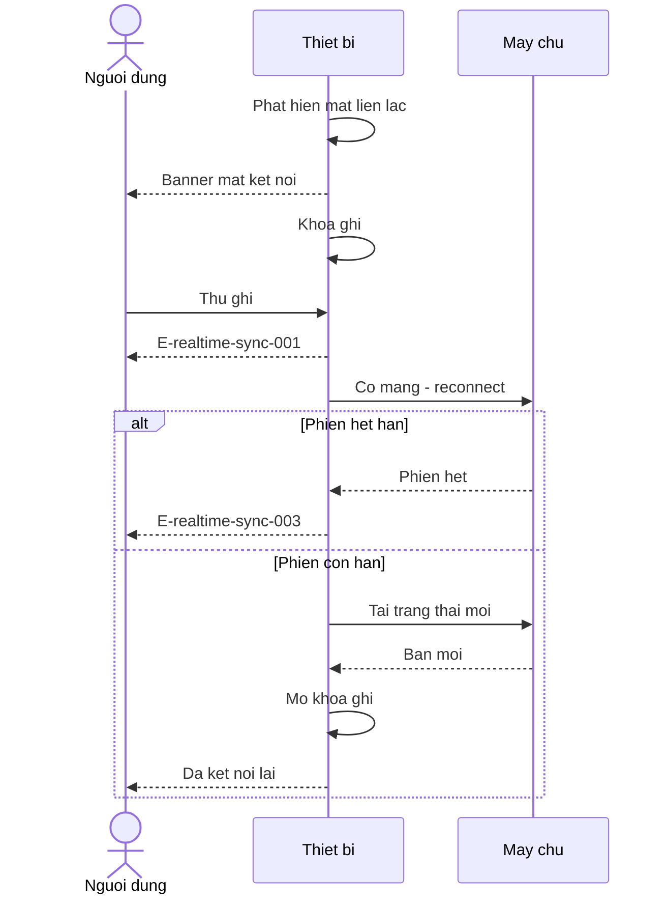
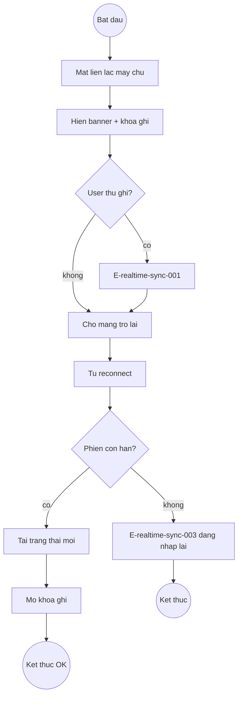

# realtime-sync — Flows

## Flow: Lan truyền cập nhật (Sequence)

**Related UC**: [[../usecases/uc-lan-truyen-cap-nhat.md]]
**Related FR**: FR-realtime-sync-001, FR-realtime-sync-002
**Related E**: E-realtime-sync-004

## Flow: Lan truyền cập nhật (Activity)

## Flow: Xung đột phiên bản (Sequence)

**Related UC**: [[../usecases/uc-xu-ly-xung-dot.md]]
**Related FR**: FR-realtime-sync-003, FR-realtime-sync-004
**Related E**: E-realtime-sync-002

## Flow: Xung đột phiên bản (Activity)

## Flow: Mất kết nối / reconnect (Sequence)

**Related UC**: [[../usecases/uc-xu-ly-mat-ket-noi.md]]
**Related FR**: FR-realtime-sync-005, FR-realtime-sync-006, FR-realtime-sync-010
**Related E**: E-realtime-sync-001, E-realtime-sync-003

## Flow: Mất kết nối / reconnect (Activity)

