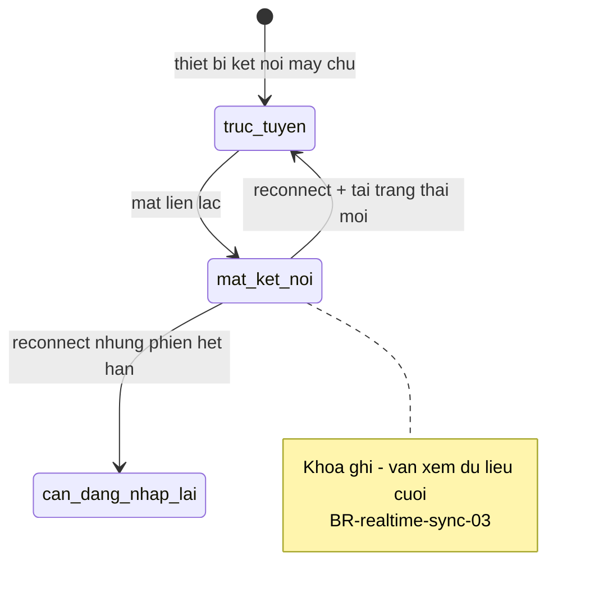
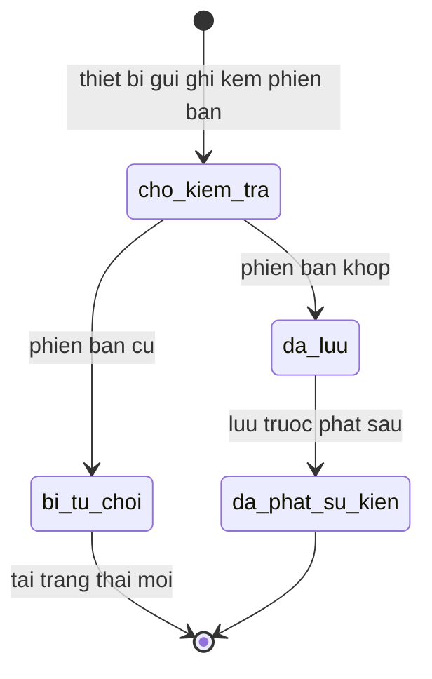

# realtime-sync — States

## State: KetNoiThietBi

**Related entity**: KetNoiThietBi
**Related UC**: [[../usecases/uc-xu-ly-mat-ket-noi.md]]
**Related BR**: BR-realtime-sync-03, BR-realtime-sync-04

### Invalid transitions

| From | To | Why not |
|---|---|---|
| mat_ket_noi | truc_tuyen | Không mở khóa ghi trước khi tải trạng thái mới (BR-realtime-sync-04) |

## State: GhiDoiTuong

**Related entity**: PhienBanDoiTuong / thao tác ghi
**Related UC**: [[../usecases/uc-xu-ly-xung-dot.md]]
**Related BR**: BR-realtime-sync-02

### Invalid transitions

| From | To | Why not |
|---|---|---|
| cho_kiem_tra | da_phat_su_kien | Không phát sự kiện khi chưa lưu (BR-realtime-sync-01) |
| bi_tu_choi | da_luu | Từ chối không được ghi đè |
