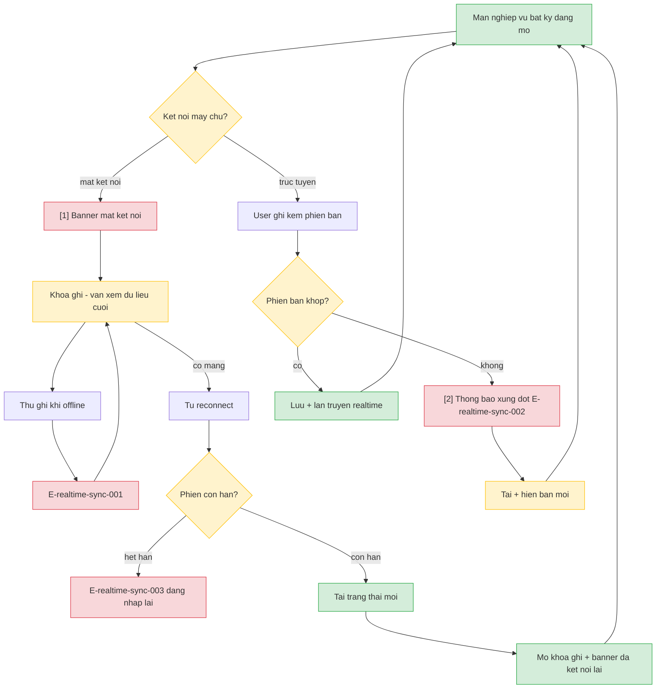

# realtime-sync — User Flow

> Feature nền — UX tập trung banner kết nối + thông báo xung đột. Batch-authorized by Devin.

## 1. User Flow (tổng)

## 2. Danh sách màn hình

| [#] | Slug | Màn hình | Mục đích | Thuộc flow |
|-----|------|----------|----------|------------|
| 1 | banner-ket-noi | Banner trạng thái kết nối | Báo mất kết nối / đã kết nối lại trên mọi màn | ket-noi |
| 2 | thong-bao-xung-dot | Thông báo xung đột phiên bản | Báo dữ liệu vừa được cập nhật + đã tải bản mới | xung-dot |

## 3. Danh sách flow

| Flow-slug | Tên flow | Màn hình gồm | Cases phủ |
|-----------|----------|--------------|-----------|
| ket-noi | Mất kết nối / reconnect | banner-ket-noi | happy reconnect, error offline ghi, edge phiên hết hạn |
| xung-dot | Xung đột phiên bản | thong-bao-xung-dot | happy từ chối + tải mới |

## 3.5. Chuyển màn (transitions)

| Từ màn [#] | Đến màn [#] | Trigger | Điều kiện |
|-----------|------------|---------|-----------|
| Màn nghiệp vụ bất kỳ | Banner kết nối [1] | Mất liên lạc máy chủ | Overlay/banner trên màn hiện tại |
| Màn nghiệp vụ bất kỳ | Thông báo xung đột [2] | Ghi bị từ chối do phiên bản cũ | Toast/banner trên màn hiện tại |

## 4. Open Questions

> Canonical: `srs/realtime-sync-spec.md` Mục 14 — chỉ ref.

- [ ] OQ-1: xem `spec.md#OQ-1` — Thiết bị báo mất kết nối sau tối đa bao lâu?
- [ ] OQ-2: xem `spec.md#OQ-2` — Người bị từ chối ghi đè có cần giữ nội dung vừa nhập?
- [ ] OQ-3: xem `spec.md#OQ-3` — Tải trạng thái mới khi reconnect là toàn bộ hay chỉ phần đã đổi?
