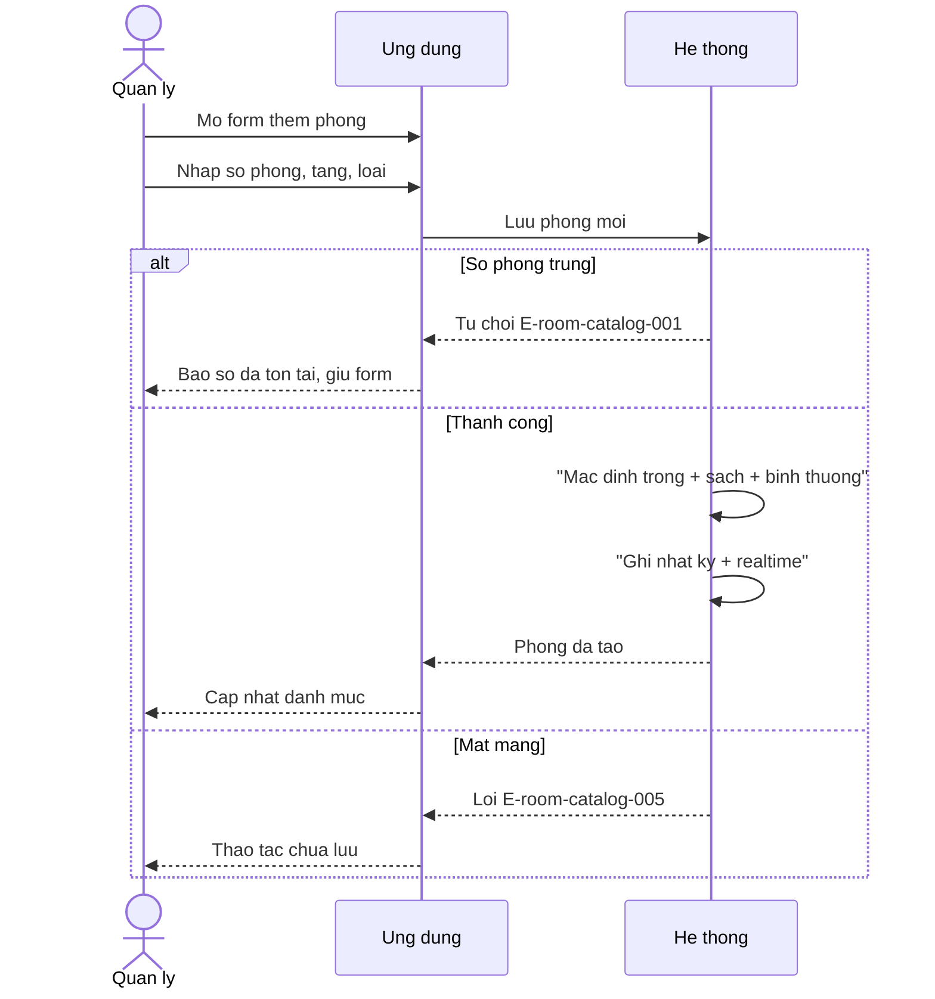
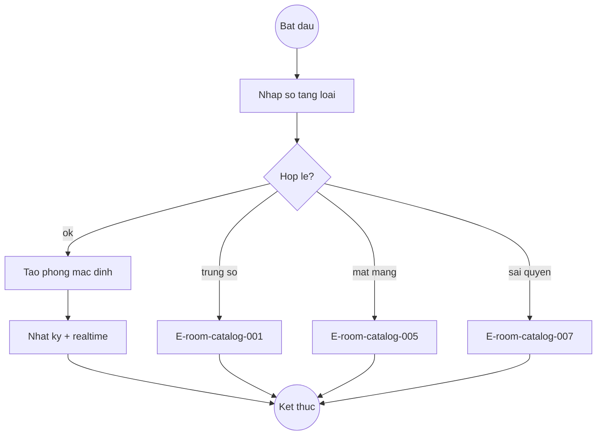
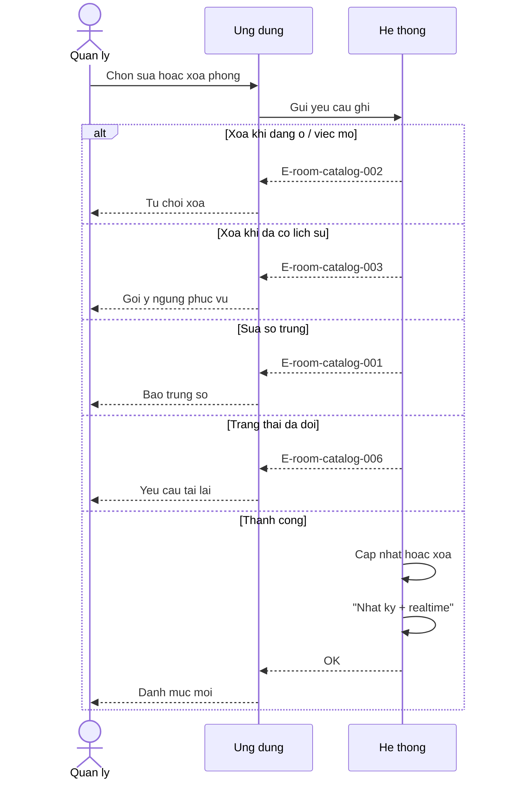
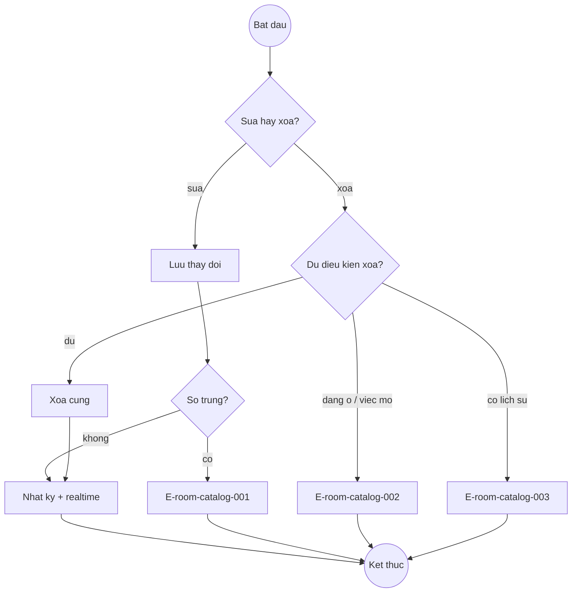
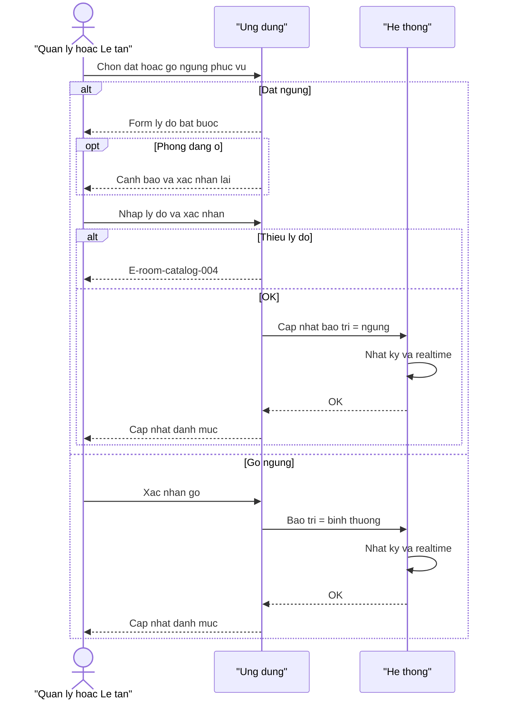
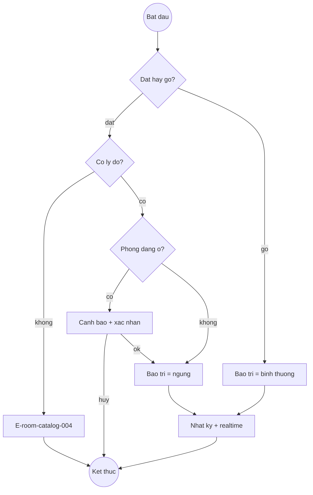
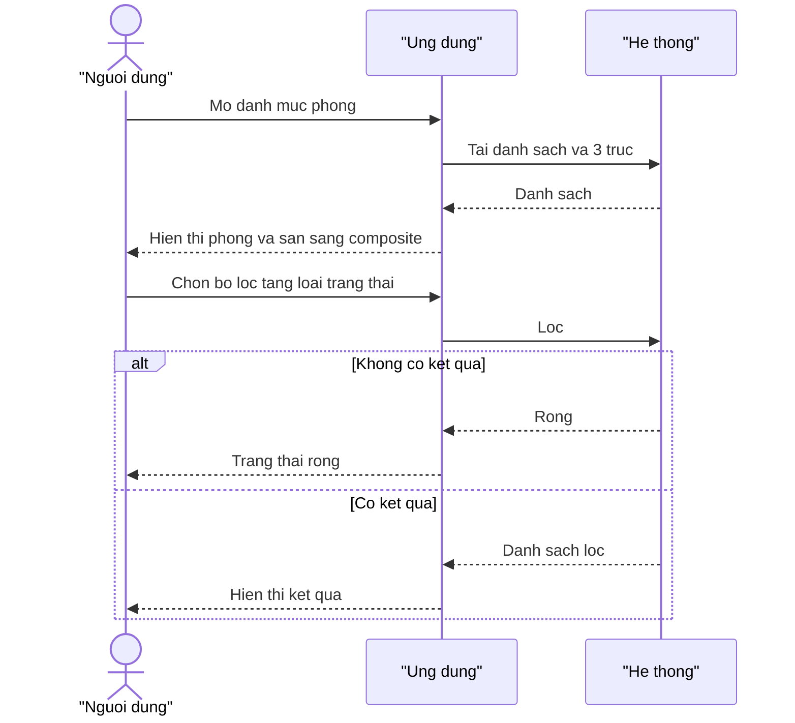
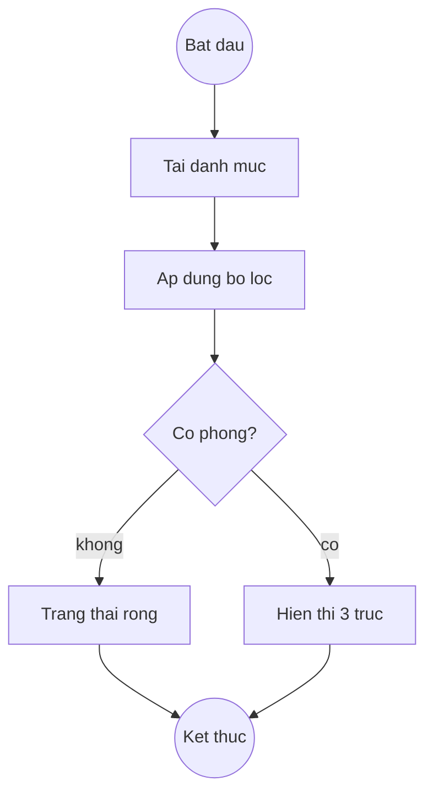

# Room Catalog — Flows

## Flow: Them phong
**Trigger**: Quan ly bam "Them phong"
**Related UC**: [[../usecases/uc-them-sua-xoa-phong.md]]
**Related FR**: FR-room-catalog-001, FR-room-catalog-002, FR-room-catalog-012
**Related E**: E-room-catalog-001, E-room-catalog-005, E-room-catalog-007

## Flow: Sua / xoa phong
**Trigger**: Quan ly chon sua hoac xoa phong
**Related UC**: [[../usecases/uc-them-sua-xoa-phong.md]]
**Related FR**: FR-room-catalog-003, FR-room-catalog-004
**Related E**: E-room-catalog-001, E-room-catalog-002, E-room-catalog-003, E-room-catalog-006

## Flow: Dat / go ngung phuc vu
**Trigger**: Quan ly hoac le tan dat/go ngung phuc vu
**Related UC**: [[../usecases/uc-dat-go-ngung-phuc-vu.md]]
**Related FR**: FR-room-catalog-007, FR-room-catalog-008
**Related E**: E-room-catalog-004

## Flow: Tra cuu / loc
**Trigger**: Actor mo danh muc va ap dung bo loc
**Related UC**: [[../usecases/uc-tra-cuu-loc-phong.md]]
**Related FR**: FR-room-catalog-005, FR-room-catalog-006

