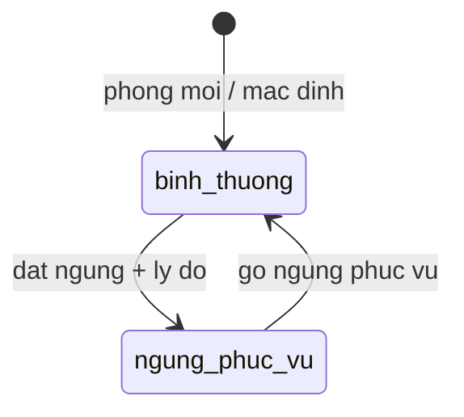
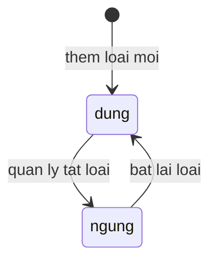

# Room Catalog — States

## State: Phong — trục bảo trì
**Related entity**: Phong.truc_bao_tri
**Related UC**: [[../usecases/uc-dat-go-ngung-phuc-vu.md]]
**Related FR**: FR-room-catalog-007, FR-room-catalog-008

### Invalid transitions

| From | To | Why not |
|---|---|---|
| binh_thuong | binh_thuong | Dat ngung bat buoc ly do — khong dat lai khi dang binh thuong |
| ngung_phuc_vu | [*] | Khong xoa cung chi bang cach dat ngung |

## State: LoaiPhong
**Related entity**: LoaiPhong
**Related UC**: [[../usecases/uc-quan-ly-loai-phong.md]]
**Related FR**: FR-room-catalog-010

### Invalid transitions

| From | To | Why not |
|---|---|---|
| ngung | [*] | Tat loai khong xoa lich su — phong cu van tham chieu |

## Ghi chú trục khác

- Trục lưu trú (`trong` / `dang_o`) đổi qua feature `check-in-out` — không sở hữu bởi room-catalog.
- Trục vệ sinh đổi qua `housekeeping` / sự kiện trả phòng — room-catalog chỉ hiển thị.
- "Sẵn sàng" = trống + sạch + bình thường — giá trị suy ra, không phải state lưu riêng (FR-room-catalog-005).
