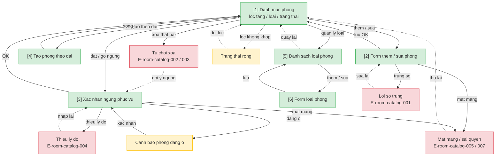

# Room Catalog — User Flow

> Nguồn chia flow DUY NHẤT. Batch-authorized by Devin (Tầng 2→4, bỏ L1/HARD STOP).

## 1. User Flow (tổng)

## 2. Danh sách màn hình

| [#] | Slug | Màn hình | Mục đích | Thuộc flow |
|-----|------|----------|----------|------------|
| 1 | room-list | Danh mục phòng | Tra cứu/lọc 3 trục; lối vào CRUD, ngừng phục vụ, tạo dải, loại | browse-rooms, manage-room, stop-service, bulk-create |
| 2 | room-form | Form thêm/sửa phòng | Nhập số/tầng/loại | manage-room |
| 3 | stop-service-confirm | Xác nhận ngừng phục vụ | Lý do bắt buộc; cảnh báo nếu đang ở | stop-service |
| 4 | bulk-create | Tạo theo dải | Tầng + khoảng số + loại | bulk-create |
| 5 | room-type-list | Danh sách loại phòng | Xem/tắt loại | manage-room-type |
| 6 | room-type-form | Form loại phòng | Thêm/sửa tên loại | manage-room-type |

## 3. Mục chia flow

| Flow-slug | Tên flow | Màn hình gồm | Cases phủ |
|-----------|----------|--------------|-----------|
| browse-rooms | Tra cứu / lọc | room-list | happy, edge (rỗng) |
| manage-room | Thêm / sửa / xóa phòng | room-list → room-form | happy, error (trùng số, chặn xóa, mất mạng) |
| stop-service | Đặt / gỡ ngừng phục vụ | room-list → stop-service-confirm | happy, error (thiếu lý do), edge (đang ở) |
| bulk-create | Tạo theo dải | room-list → bulk-create | happy, edge (bỏ qua số trùng) |
| manage-room-type | Quản lý loại phòng | room-type-list → room-type-form | happy, error (mất mạng/sai quyền) |

## 3.5. Chuyển màn (transitions)

| Từ màn [#] | Đến màn [#] | Trigger | Điều kiện |
|-----------|------------|---------|-----------|
| Danh mục phòng [1] | Form thêm/sửa [2] | Bấm Thêm / Sửa | Quyền quản lý (OQ-1 lễ tân) |
| Form thêm/sửa [2] | Danh mục phòng [1] | Lưu thành công / Hủy | — |
| Danh mục phòng [1] | Xác nhận ngừng [3] | Đặt/gỡ ngừng phục vụ | — |
| Xác nhận ngừng [3] | Danh mục phòng [1] | Xác nhận / Hủy | — |
| Danh mục phòng [1] | Tạo theo dải [4] | Bấm Tạo theo dải | Quản lý |
| Tạo theo dải [4] | Danh mục phòng [1] | Xong / Hủy | — |
| Danh mục phòng [1] | Danh sách loại [5] | Quản lý loại | Quản lý |
| Danh sách loại [5] | Form loại [6] | Thêm / Sửa | — |
| Form loại [6] | Danh sách loại [5] | Lưu / Hủy | — |

## 4. Open Questions

- [ ] `spec.md#OQ-1` — Quyền lễ tân với danh mục
- [ ] `spec.md#OQ-2` — Cách nạp danh mục 50 phòng ban đầu
- [ ] `spec.md#OQ-3` — Quy ước đánh số phòng
