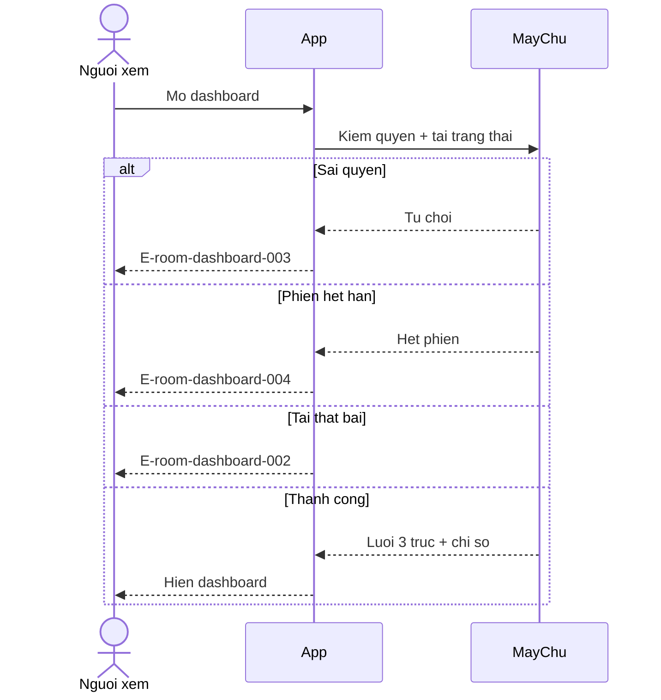
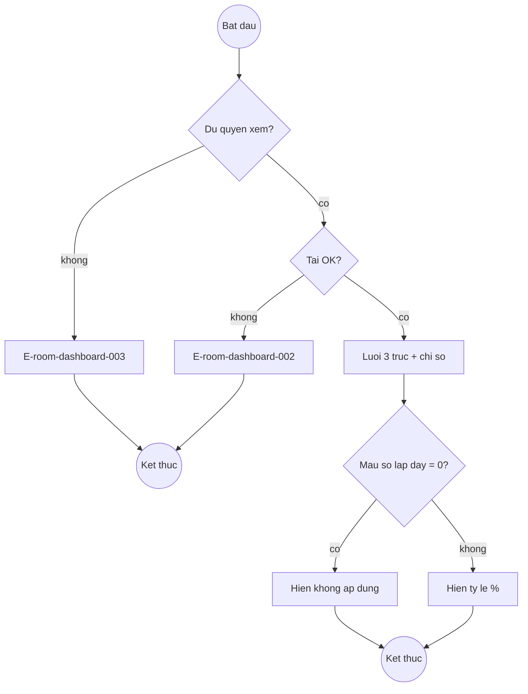
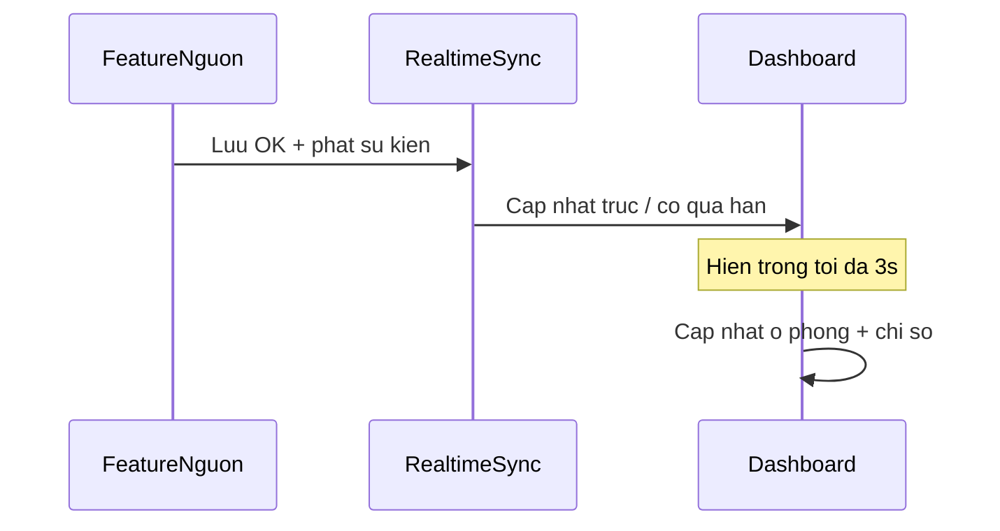
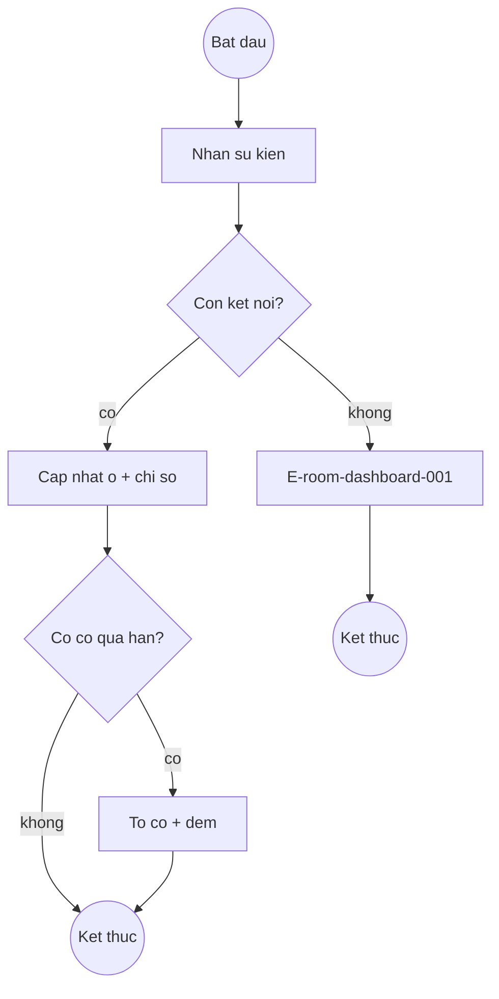
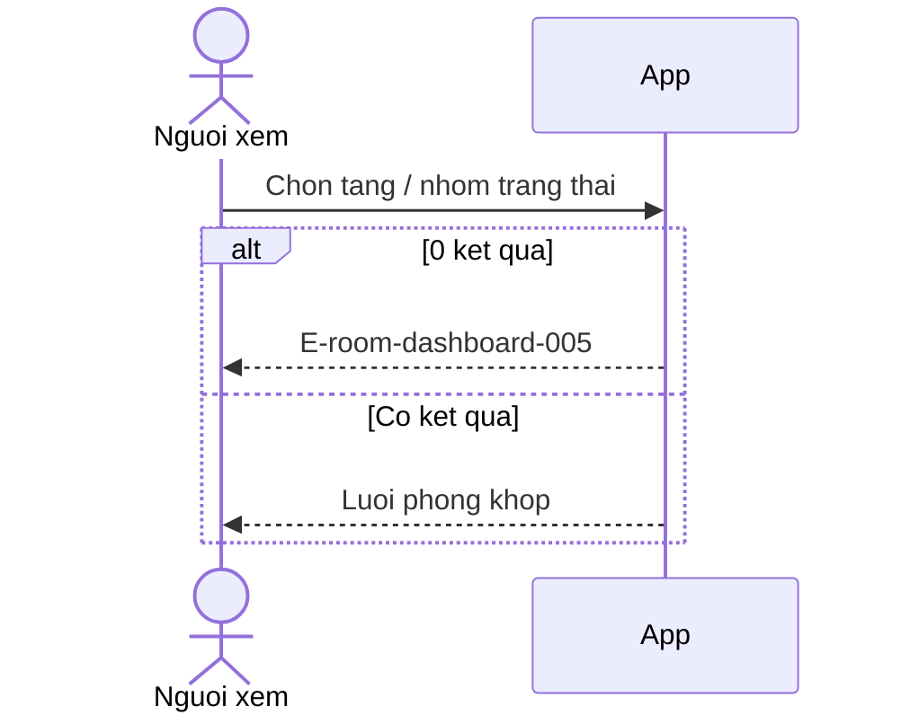
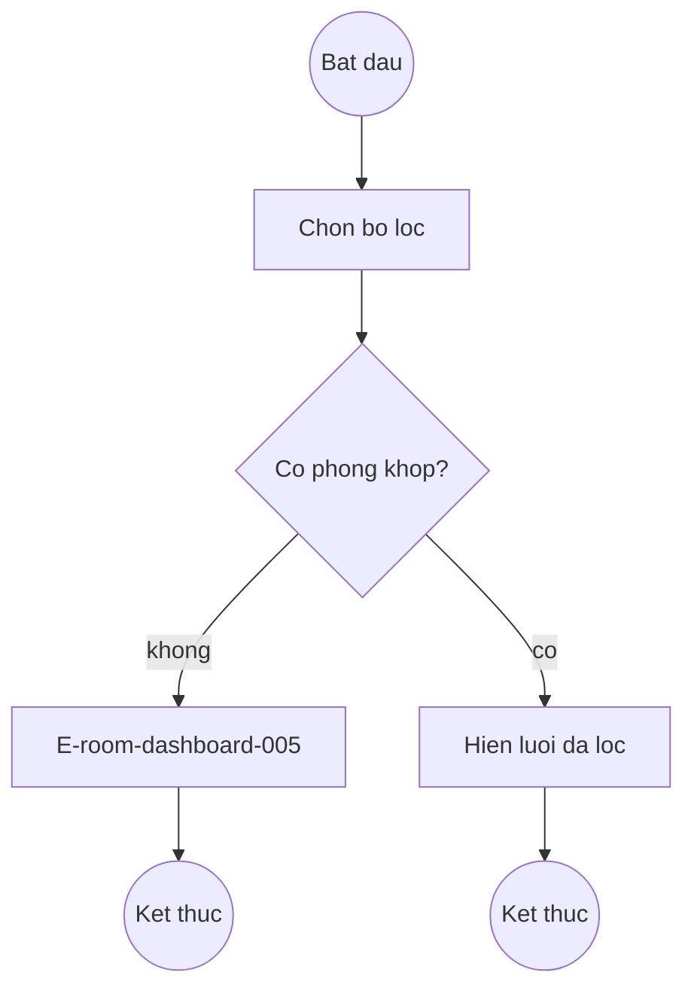
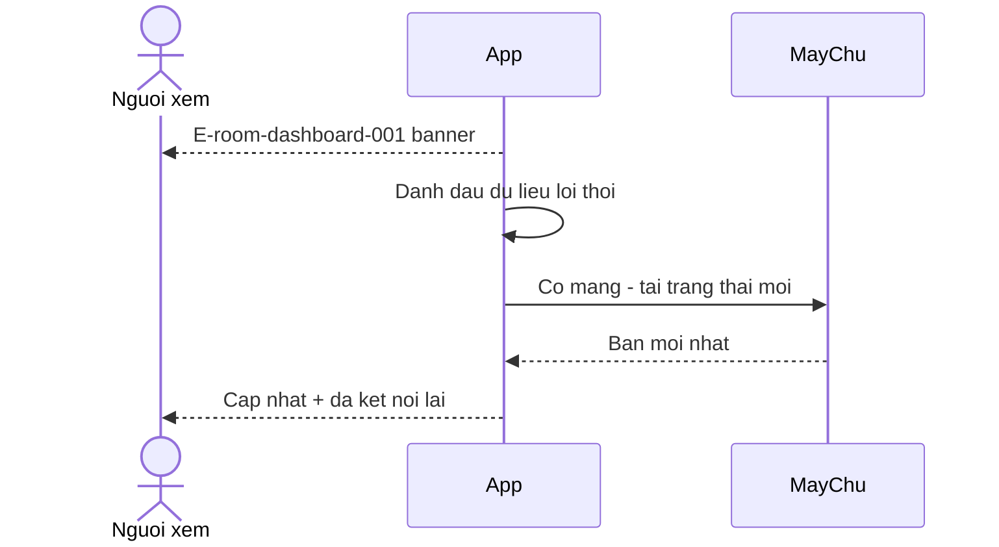
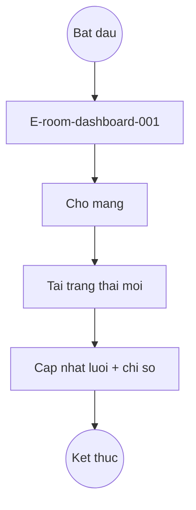

# room-dashboard — Flows

## Flow: Mở dashboard (Sequence)

**Related UC**: [[../usecases/uc-mo-va-xem-dashboard.md]]
**Related FR**: FR-room-dashboard-001, FR-room-dashboard-002, FR-room-dashboard-008, FR-room-dashboard-010
**Related E**: E-room-dashboard-002, E-room-dashboard-003, E-room-dashboard-004

## Flow: Mở dashboard (Activity)

## Flow: Realtime + cờ quá hạn (Sequence)

**Related UC**: [[../usecases/uc-theo-doi-realtime-va-qua-han.md]]
**Related FR**: FR-room-dashboard-005, FR-room-dashboard-006
**Related E**: E-room-dashboard-001

## Flow: Realtime + cờ quá hạn (Activity)

## Flow: Lọc phòng (Sequence)

**Related UC**: [[../usecases/uc-loc-phong.md]]
**Related FR**: FR-room-dashboard-007
**Related E**: E-room-dashboard-005

## Flow: Lọc phòng (Activity)

## Flow: Mất kết nối dashboard (Sequence)

**Related UC**: [[../usecases/uc-xu-ly-mat-ket-noi-dashboard.md]]
**Related FR**: FR-room-dashboard-009
**Related E**: E-room-dashboard-001

## Flow: Mất kết nối dashboard (Activity)

