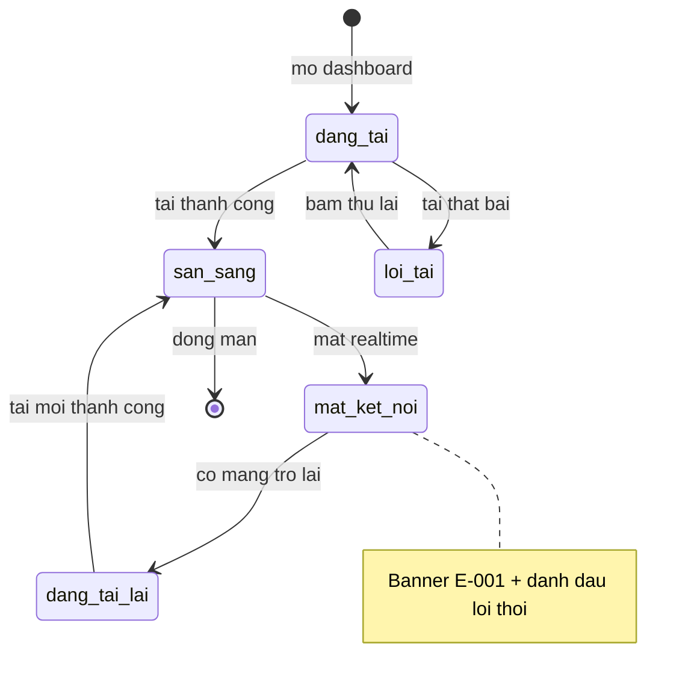

# room-dashboard — States

> Trạng thái 3 trục phòng thuộc feature nguồn. Dashboard chỉ có trạng thái phiên xem / kết nối.

## State: PhienXemDashboard

**Related UC**: [[../usecases/uc-mo-va-xem-dashboard.md]], [[../usecases/uc-xu-ly-mat-ket-noi-dashboard.md]]

### Invalid transitions

| From | To | Why not |
|---|---|---|
| loi_tai | san_sang | Phải tải lại thành công |
| mat_ket_noi | san_sang | Phải tải trạng thái mới, không ghép dữ liệu cũ |
