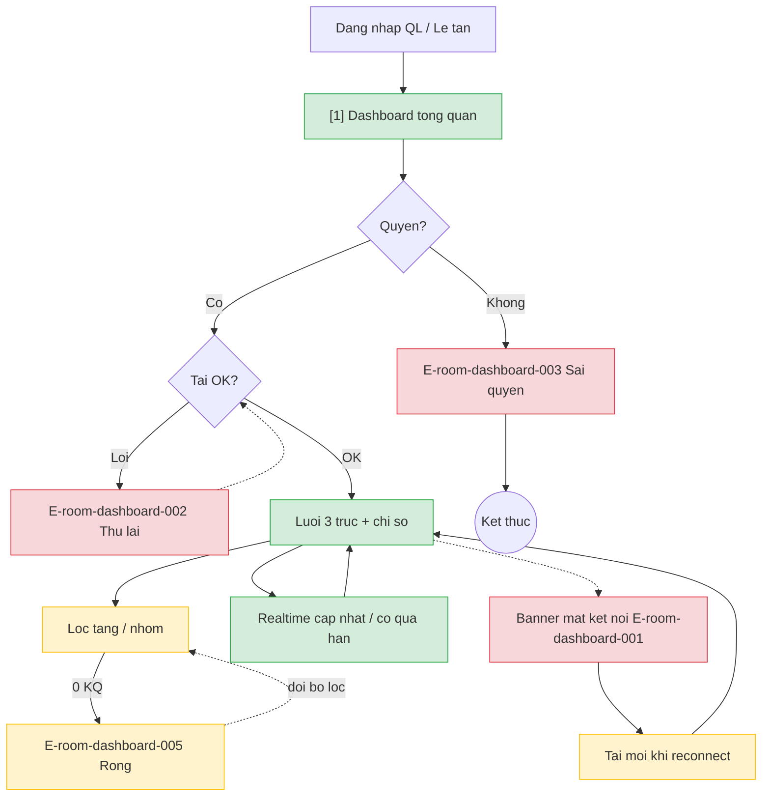

# room-dashboard — User Flow

> Batch-authorized by Devin. Dashboard v1 web (OQ-3 Android). Wireframe mobile-width.

## 1. User Flow (tổng)

## 2. Danh sách màn hình

| [#] | Slug | Màn hình | Mục đích | Thuộc flow |
|-----|------|----------|----------|------------|
| 1 | dashboard-tong-quan | Dashboard tổng quan | Lưới 3 trục + chỉ số + lọc + banner kết nối | xem-dashboard |

## 3. Danh sách flow

| Flow-slug | Tên flow | Màn hình gồm | Cases phủ |
|-----------|----------|--------------|-----------|
| xem-dashboard | Xem / lọc / realtime / offline | dashboard-tong-quan | happy, error (quyền, tải, offline), edge (lọc rỗng, mẫu=0) |

## 3.5. Chuyển màn

| Từ | Đến | Trigger | Điều kiện |
|----|-----|---------|-----------|
| Dashboard [1] | Chi tiết phòng (TBD) | Chạm ô phòng | Phụ thuộc OQ-4 |

## 4. Open Questions

- [ ] OQ-1: `spec.md#OQ-1` — ngưỡng quá hạn bảo trì
- [ ] OQ-2: `spec.md#OQ-2` — định nghĩa chỉ số/lọc "cần dọn"
- [ ] OQ-3: `spec.md#OQ-3` — Android?
- [ ] OQ-4: `spec.md#OQ-4` — màn chi tiết phòng?
